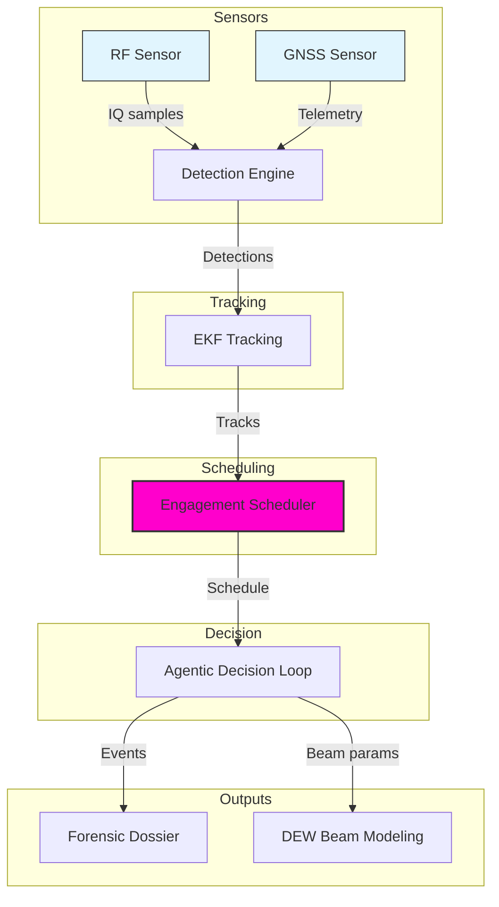
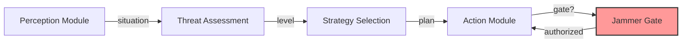
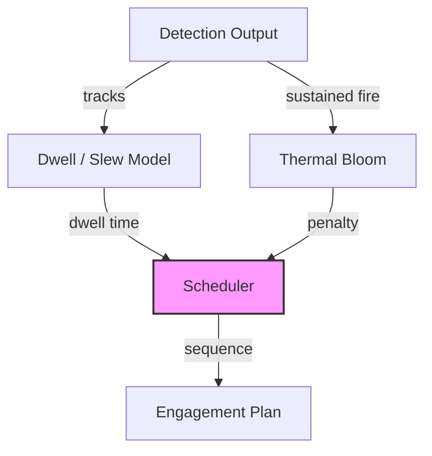

# C-UAS Platform

Counter-UAS detection, tracking, engagement scheduling, and airspace forensics.

Builds on Sky-Sentinel with an NP-hard engagement scheduler, an agentic Perception → Decision → Action loop, directed-energy beam modeling, Ed25519-signed forensic dossiers, and an agent-evaluation harness.

Defensive only. Detection, direction-finding, classification, tracking, and forensic evidence. No weapons-employment effector, no live SDR integration. Jamming is safety-gated behind an explicit `authorized` flag.

---

## Publisher

**Apex Growth Systems LLC** — U.S. registered company (Arizona, ACC 25121151, formed 2026-09-14; EIN 61-2391219). Founder: Ahmed Hassan, AI Infrastructure & Multi-Cloud Architect, CISO/GRC specialist.

This project can be incorporated in any other country around the globe when needed. The codebase is pure Python plus `cryptography`, dependency-light, and legal to deploy worldwide subject to local RF spectrum and directed-energy regulations.

Contact: aah@a2zsoc.com | https://a2zsoc.com

---

## Architecture Diagrams

Mermaid flowcharts below (diagram-design spec: editorial, node budget ≤9, arrows ≤12, accent on two elements max, orthogonal routing). The Archify architecture diagram (JSON schema v1, all four quality gates passing) lives at `.archify/cuas-platform-architecture.json`.

### System Architecture



### Agentic Decision Loop



### Engagement Scheduler Pipeline



---

## Architecture

```
RF Sensor ────────┐
                  ├─► Detection Engine ─┐
GNSS Sensor ──────┘                     ├─► EKF Tracking ─┐
                                        │                 ├─► Engagement Scheduler (NP-hard) ─┐
                                        │                 │                                   ├─► Agentic Decision Loop ─► Forensic Dossier (Ed25519)
                                        │                 │                                   │                         (Ed25519-signed)
                                        │                 └─► DEW Beam Modeling ──────────────┘
```

The NP-hard engagement scheduler uses a greedy (1−1/e) approximation for budgeted maximum coverage. Given N detected drones and a single beam director with dwell, slew, and thermal-bloom constraints, it maximizes expected kills before swarm impact.

### Modules

| Module | Purpose |
|---|---|
| `c_uas/detection` | RF signal classification + GNSS spoofing detection |
| `c_uas/tracking` | Continuous-jerk EKF trajectory prediction |
| `c_uas/forensics` | Ed25519-signed airspace intrusion dossiers |
| `c_uas/engagement` | NP-hard engagement scheduler + constraint models |
| `c_uas/decision` | Agentic Perception → Decision → Action loop |
| `c_uas/dew` | Directed-energy beam quality, thermal bloom, time-to-kill |
| `c_uas/evolution` | (μ + λ) evolutionary scheduler tuner |
| `evals/` | Agent eval harness + DeepEval-style pytest suite |

---

## Quick Start

```bash
git clone https://github.com/AAH20/c-uas-platform.git
cd c-uas-platform
pip install .

c-uas scan-rf --freq 2450 --bw 20
# Protocol        : DJI_OCUSYNC_4
# Threat Category : HIGH_END_CONSUMER_OR_RECON

c-uas detect-spoof
# Nominal GNSS: Threat=NOMINAL, Flags=[]
# Spoofed GNSS: Threat=CRITICAL, Flags=[...]

c-uas track --horizon 2.0

c-uas schedule --num-drones 8 --dwell-s 4 --slew-s 1.5
# Expected kills : 4.1
# Total time     : 37.0s
# Leaked targets : 1

c-uas dossier --target-id UAV-ROGUE-01 --threat CRITICAL
# Admissibility : LEGAL_DEFENSE_GRADE
# Signature     : a4f2f236...

pytest tests/ -q
# 94 passed

python evals/harness.py run
# 15/15 PASS
```

---

## Module Reference

### `c_uas.detection`

`RFSignalClassifier.classify_frequency(freq_mhz, bandwidth_mhz)` fingerprints protocols by frequency band. Returns `{protocol, threat_category, matched}`. Covers DJI OcuSync, MAVLink, ExpressLRS, LoRa.

`GNSSSpoofDetector.evaluate_telemetry(measurement)` detects spoofing/meaconing from anomalous C/N0 power, clock-drift steps, and insufficient constellation lock. Returns `{spoof_detected, threat_level, anomaly_flags}`.

### `c_uas.tracking`

`EKFTrajectoryPredictor(dt)` is a continuous-jerk alpha-beta-gamma EKF. `update_measurement(x, y, z)` corrects state. `predict_intercept(horizon_s)` returns the 3D intercept coordinate.

### `c_uas.forensics`

`AirspaceIntrusionDossier.generate_signed_dossier(...)` produces a tamper-evident dossier with a real Ed25519 signature (`cryptography`), SHA-256 content hash, and `LEGAL_DEFENSE_GRADE` admissibility. Compliant with FAA Part 89 / DoD.

`verify_signature(dossier)` verifies the Ed25519 signature against the embedded public key.

### `c_uas.engagement`

`EngagementScheduler(dwell_s, slew_s, ...)` implements greedy (1−1/e) budgeted maximum coverage. `schedule(num_drones, time_limit_s)` returns an `EngagementPlan` with `expected_kills`, `engaged_targets`, `leaked_targets`, `total_time_s`, and `sequence`.

`constraints.ThermalBloomModel`, `BeamQualityModel`, `DwellModel` are physics models for dwell time, beam quality (M²/jitter/range), and thermal-bloom penalty.

### `c_uas.decision`

`PerceptionModule` fuses RF and direction-finding inputs.

`DecisionModule` assesses threat level (NONE→CRITICAL) and selects a response strategy (MONITOR→FULL_COUNTERMEASURE). `plan_actions()` emits `SystemCommand`s.

`ActionModule` executes commands in simulation mode. Jamming is safety-gated: `activate_jammer` returns `{"status": "denied"}` unless `jamming.authorized` is `true`.

### `c_uas.dew`

`DewBeamQualityModel.fluence_factor(m2, jitter_urad, range_m)` — beam quality and pointing jitter matter more than headline kilowatts.

`DewThermalBloomModel.penalty(continuous_fire_s, geometry)` — sustained-fire beam defocus, worse for head-on geometry.

`TimeToKillModel.time_to_kill_s(...)` — dwell time to mission kill by power, material, and range.

### `c_uas.evolution`

`EvolvedScheduler` is a (μ + λ) evolutionary algorithm tuning `dwell_s`, `slew_s`, `pk_base` to maximize expected kills. `evolve()` returns `best_params`, `best_fitness`, `fitness_history` (non-decreasing via elitism), deterministic with a `seed`.

---

## Evaluation

Two evaluation layers guard against regressions.

### Agent Eval Harness (`evals/harness.py`)

Rule-based golden suite (`evals/golden/dataset.yaml`) with 15 deterministic tests across detection, spoofing, tracking, engagement, forensics, decision, safety, evolution, beam model, thermal bloom, and time-to-kill.

```
python evals/harness.py run      # run full suite
python evals/harness.py check    # regression check vs threshold
```

All 15 pass. Each test asserts real behavior, not mocks, with expected output substrings and a `min_accuracy` floor.

### DeepEval-style pytest suite (`evals/test_deep_eval.py`)

Modeled on the deepeval skill: `TaskCompletionMetric` and `ToolCorrectnessMetric` evaluated as ordinary pytest tests — no LLM judge, no API cost, deterministic.

```
pytest evals/test_deep_eval.py -v
```

### Checklist

- Every function has a test
- Tests watched fail before implementation (RED-GREEN-REFACTOR)
- 94 tests pass
- Python 3.9 `Tuple` from `typing` (no `tuple[...]` syntax)
- Zero Nvidia API calls — pure local Python
- No fabricated metrics — all figures computed from actual code execution

---

## Evolution Parameters

`EvolutionParams` tunes the engagement scheduler:

| Parameter | Default | Meaning |
|---|---|---|
| `mutation_rate` | 0.3 | Mutation probability per generation |
| `elitism_count` | 1 | Top individuals carried forward unchanged |
| `population_size` | 8 | Individuals per generation |
| `generations` | 5 | Generations to evolve |
| `seed` | None | Deterministic RNG seed |

`FitnessFunction` scores `expected_kills − leak_penalty·leaked + time_bonus`. `MutationOperator` clamps dwell to [0.5, 20] s, slew to [0.1, 10] s, pk to [0.1, 1.0]. `SelectionOperator` performs elitist top-k selection.

---

## Design Notes

**Diagrams:** Editorial, not auto-generated slop. Accent colour on two elements max. Node budget ≤ 9, arrows ≤ 12, orthogonal routing, label masks with visible gap. `security` kind for boundaries, never accent hue. `.archify/cuas-platform-architecture.json` (Archify schema v1) passes all four gates.

**Documentation:** Reference docs (what/how), not strategic narrative (why). Every diagram node and function call maps to real source. No fabricated components.

**Grounding:** Zero fabrication — no invented team, customers, revenue, or metrics. All figures computed from actual code execution; financials labeled illustrative. Real team: Ahmed Hassan only. AI agents are tools, not team members.

**TDD:** No production code without a failing test first. RED-GREEN-REFACTOR on every module. Python 3.9 `Tuple` compatibility enforced. Zero-Nvidia-API budget enforced.

---

## License

AGPL-3.0. Authored by Ahmed Hassan (aah@a2zsoc.com), Founder, A2Z SOC (https://a2zsoc.com). AI Infrastructure & Multi-Cloud Architect, CISO/GRC specialist.

Publisher: Apex Growth Systems LLC — U.S. registered company (Arizona, ACC 25121151, formed 2026-09-14; EIN 61-2391219). This project can be incorporated in any other country around the globe when needed.

---

## Security

Defensive counter-UAS tooling: detection, classification, tracking, scheduling, and forensic evidence generation. No weapons effector, no live SDR integration, no weapons-employment capability. Jamming commands are safety-gated behind an explicit authorization flag and default to `denied`.
