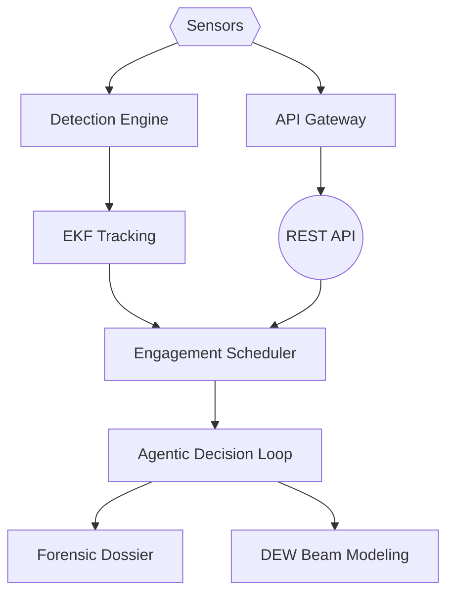
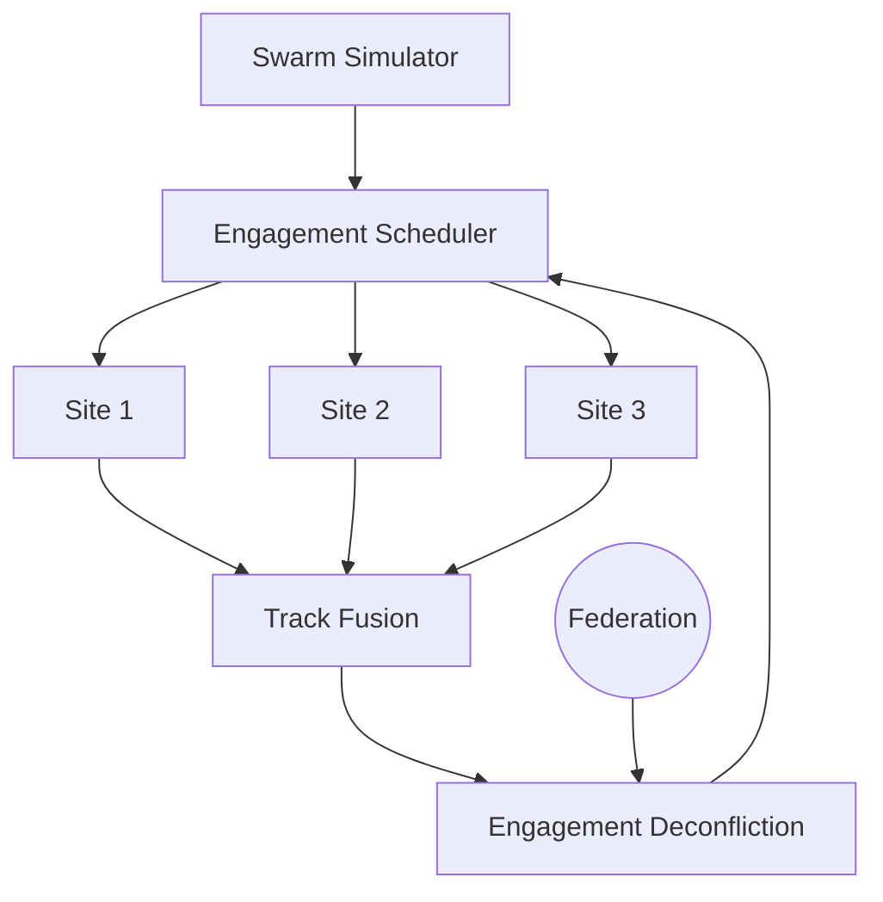
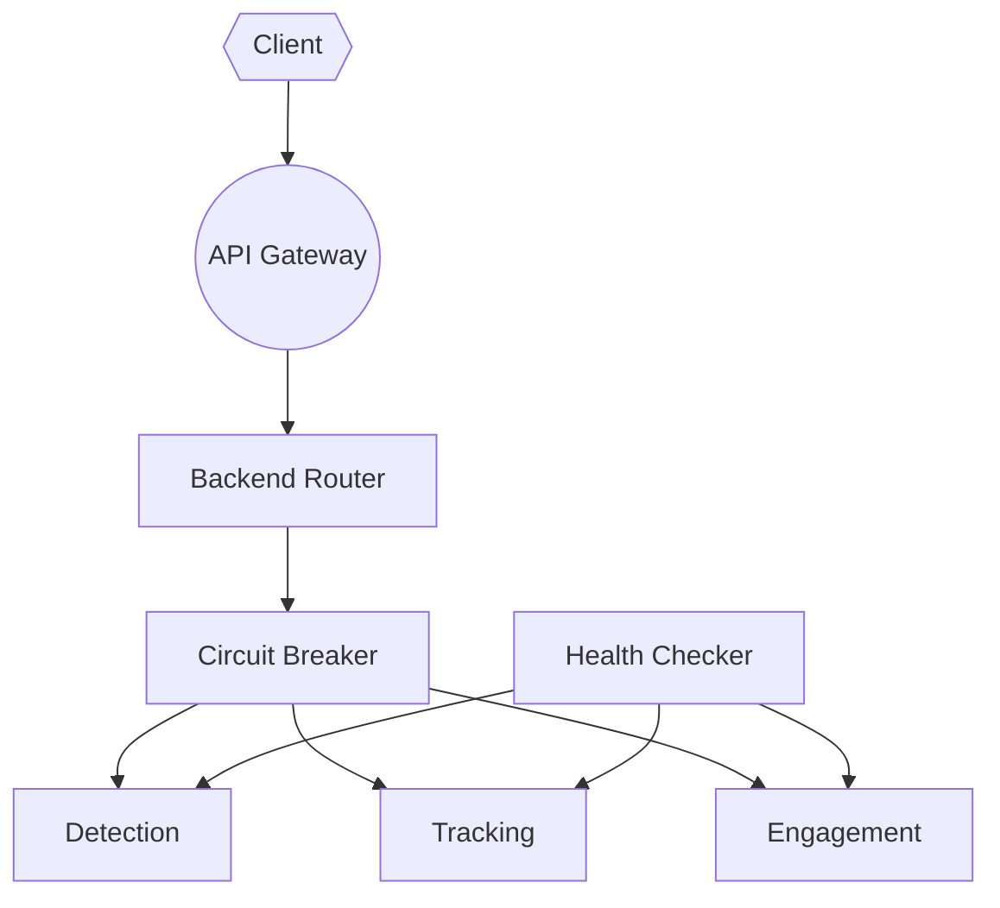

# C-UAS Platform

Counter-UAS detection, tracking, engagement scheduling, and airspace forensics.
Defensive only. Detection, direction-finding, classification, tracking, controller
geolocation, MAVLink vulnerability assessment, and forensic evidence. No
weapons-employment effector, no live SDR integration. Jamming is safety-gated
behind an explicit authorized flag.

## Publisher

Apex Growth Systems LLC - U.S. registered company (Arizona, ACC 25121151,
formed 2026-09-14; EIN 61-2391219). Founder: Ahmed Hassan, AI Infrastructure &
Multi-Cloud Architect, CISO/GRC specialist.

This project can be incorporated in any other country around the globe when needed.
The codebase is pure Python plus cryptography, dependency-light, and legal to deploy
worldwide subject to local RF spectrum and directed-energy regulations.

Contact: aah@a2zsoc.com | https://a2zsoc.com

## Platform architecture

Inline mermaid flowcharts (editorial spec: node budget <= 9, arrows <= 12,
stroke-only containers, no fill colors). Every node and edge maps to real source
in c_uas/.

### System architecture



Sensors feed the detection engine, which produces detections for EKF tracking.
Tracks flow to the NP-hard engagement scheduler, which feeds the agentic
decision loop. The loop emits forensic dossiers and DEW beam parameters. The
REST API sits on top of the scheduler, and the API Gateway fronts the API.

### Agent swarm topology



The swarm simulator produces tracks consumed by the engagement scheduler. Each
federation site contributes tracks to track fusion; fusion output is deconflicted
so no two sites engage the same drone, and the scheduler assigns engagements
back to each site.

### Gateway routing flow



A client request enters the API Gateway, which routes through a backend router
protected by a per-backend circuit breaker. The router selects detection,
tracking, or engagement backends. A health checker probes each backend and marks
it healthy or unhealthy so the breaker can open on repeated failures.

## Quick start

```bash
git clone https://github.com/AAH20/Apex_C-UAS.git
cd c-uas-platform
pip install .
```

### CLI examples

```bash
c-uas scan-rf --freq 2450 --bw 20
c-uas detect-spoof
c-uas track --horizon 2.0
c-uas schedule --num-drones 8 --dwell-s 4 --slew-s 1.5
c-uas dossier --target-id UAV-ROGUE-01 --threat CRITICAL
c-uas mavlink-vulns --severity CRITICAL
c-uas locate-controller --method BEARING
c-uas competitive-landscape
c-uas unit-economics --type all
c-uas benchmarks --max-drones 64
c-uas perf --benchmark --module default --seed 7
c-uas perf --profile --module default --seed 7
c-uas perf --sla --module default --seed 7
c-uas dew --laser fiber_50kw --range-m 3000 --material aluminum
c-uas opendew --samples 100
c-uas contract-readiness
c-uas contract --verify --spec openapi.yaml
c-uas contract --breaking --spec openapi.yaml --old-spec openapi.prev.yaml
c-uas contract --gate --spec openapi.yaml
c-uas governance --action compliance-report
c-uas grc-clab --action monitor
c-uas grc --chain
c-uas grc --monitor
c-uas grc --remediate
c-uas hardware --list --scan --fuse --status
c-uas edge --status
c-uas edge --tenant --register-tenant --tenant-id T-1 --name "Site One" --region us-east-1 --tier standard
c-uas edge --tenant --list-tenants
c-uas edge --tenant --tenant-health --tenant-id T-1
c-uas edge --fleet --register-node --node-id N-1 --tenant-id T-1 --location "Roof A"
c-uas edge --fleet --heartbeat --node-id N-1
c-uas edge --fleet --fleet-health
c-uas edge --zero-trust --evaluate-policy --source node-A --dest node-B --port 443 --mtls --same-segment --authenticated
c-uas gateway --status --route --backend detection
c-uas chaos --report
c-uas dc --capacity
c-uas dc --lifecycle
 c-uas dc --efficiency
 c-uas forecast --demand --horizon 30
 c-uas forecast --capacity --horizon 30 --stream api_traffic
c-uas finops --cost
c-uas finops --unit
c-uas finops --carbon
c-uas finops --optimize
c-uas readiness --check
c-uas readiness --report
c-uas dr --backup
c-uas dr --rpo-rto --rpo-threshold-s 3600
c-uas dr --restore --backup-id <id> --target /recovery/root
c-uas red-team --scenario
c-uas red-team --run --scenario-name gnss_spoofing
c-uas red-team --run-campaign --seed 42
c-uas red-team --report
c-uas threat-intel --export --alert --test
c-uas broker --action list-tenants
c-uas orchestrate --sites 3 --drones 16
c-uas agent-eval --sites 3 --drones 16
c-uas performance --baseline --bottlenecks --capacity --optimize
c-uas compliance --collect --package --report
c-uas ir --create --type security_breach --source alert --source-id ALERT-001 --severity P1
c-uas ir --list
c-uas ir --execute --incident-id <id>
c-uas ir --escalate --incident-id <id>
c-uas api --host 127.0.0.1 --port 8000
c-uas deploy --config-check
c-uas k8s --manifests --replicas 3
c-uas k8s --dry-run --replicas 5
c-uas k8s --reconcile
c-uas dashboard --host 127.0.0.1 --port 8080
c-uas notify --channels
c-uas notify --test
c-uas notify --send
c-uas auth --create-key --label default --tenant acme --role admin
c-uas auth --list-keys
c-uas auth --check-perm --key <key> --route /status --method GET
c-uas mlops --register --name rf_clf --version 1.0.0 --artifact m.joblib --metrics-hash <sha256>
c-uas mlops --list
c-uas mlops --promote --name rf_clf --version 1.0.0 --stage production
c-uas mlops --drift --baseline baseline.json --current inference.json
c-uas mlops --ab --ab-action route --experiment-id rf-ab-1 --user-id user-42
```

Run the test suite:

```bash
pytest tests/ -q
# 455 passed
```

## CLI command reference

Generated from c_uas/cli.py subparsers. Each entry maps to a real subcommand
implemented in c_uas/cli.py.

| Command | Purpose |
|---------|---------|
| scan-rf | Classify RF emitter protocol |
| detect-spoof | Evaluate GNSS telemetry for spoofing / meaconing |
| track | Predict drone intercept trajectory (EKF) |
| schedule | Compute optimal engagement sequence |
| dossier | Generate signed airspace intrusion dossier |
| dr | Disaster Recovery / Backup: deterministic snapshots of all module state dirs, restore with SHA-256 verification, and RPO/RTO threshold tracking; state under ~/.c-uas-platform/disaster_recovery/ |
| mavlink-vulns | List MAVLink protocol vulnerabilities |
| locate-controller | Estimate controller geolocation from RF detections |
| competitive-landscape | List global deployed counter-UAS systems with unit economics |
| unit-economics | Compute unit economics for C-UAS engagement types |
| swarm | Simulate a drone swarm and test scheduler saturation |
| benchmarks | Run performance benchmarks (scheduler, EKF, end-to-end, swarm saturation) |
| chaos | Chaos / resilience testing: fault injection and resilience validation |
| dc | Data Center Lifecycle Decision Support: capacity planning, lifecycle decisions, energy-to-compute efficiency (DCC concepts) |
| forecast | Deterministic time-series forecasting of compute demand, drone track volume, and API traffic for capacity planning; state under ~/.c-uas-platform/forecasting/ |
| finops | FinOps / Cost Optimization: cost model, unit economics, carbon intensity by region, cost optimization; state under ~/.c-uas-platform/finops/ |
| governance | ISO 42001 AI governance for C-UAS systems |
| grc | GRC_Clab agentic governance: hash-linked evidence chain, compliance monitoring, remediation |
| grc-clab | Agentic ISO 42001 governance engine (AutonomousAgent, EvidenceAutoLogger, ComplianceMonitor, RemediationPlanner) |
| dew | Directed-energy beam modeling with atmospheric attenuation |
| opendew | OpenDEW neural network signal classifier |
| contract-readiness | Contract readiness: burn rate, CAC:LTV, MVP scope |
| contract | OpenAPI contract readiness: verify spec routes against the FastAPI route table, detect breaking changes between two spec versions, and CI gate with non-zero exit on missing routes or breaking changes; state under ~/.c-uas-platform/contract_readiness/ |
| api | Run the REST API server |
| deploy | Deploy the platform: Docker, Kubernetes, or config check |
| k8s | Kubernetes operator: declarative deployment and lifecycle management (CRD, Deployment, Service, ConfigMap, NetworkPolicy, PodDisruptionBudget, ResourceQuota manifests; drift detection; state under ~/.c-uas-platform/k8s_operator/; manifest generation only, no cluster access) |
| dashboard | Serve the SOC dashboard web interface |
|| notify | Alert notification delivery: email (SMTP/TLS), webhook, and Slack (Block Kit); state under ~/.c-uas-platform/notifications/ |
|| mlops | MLOps: model registry (register/list/promote/demote/archive), drift detection (KS test + chi-squared), and A/B testing with hash-based routing; state under ~/.c-uas-platform/mlops/ |
|| auth | API key authentication & RBAC: deterministic API key generation (SHA-256), role-based access control (admin/operator/viewer/auditor), route-to-permission mapping, tenant scoping; state under ~/.c-uas-platform/auth/keys/ |
| orchestrate | Run multi-site C-UAS orchestration round |
| agent-eval | Run agent reliability evaluation harness |
| threat-intel | STIX/TAXII threat intelligence export and alerting |
| broker | Broker Channel OS: multi-tenant broker management, agent slots, campaigns |
| hardware | Hardware abstraction layer: SDR, radar, camera sensors with simulation mode and track fusion |
| edge | Deploy and operate C-UAS edge nodes: local detection/tracking, edge-to-cloud sync, multi-tenant isolation (tenants, RLS, quotas), fleet management (registration, heartbeat, offline detection, decommission), and zero-trust network policies (default-deny, mTLS, segmentation) |
| engagement | Engagement scheduler backtest, evolutionary tuning, and alpha measurement vs counterfactual baselines (``--backtest``/``--evolve``/``--alpha``); state under ~/.c-uas-platform/engagement/ |
| readiness | Production readiness review: aggregates all domain checks (security, observability, contract, finops, grc, edge, datacenter) into a weighted go/no-go release decision; state under ~/.c-uas-platform/production_readiness/ |
|| red-team | Red team adversarial testing framework (GNSS spoofing, RF jamming, swarm saturation, coordinated attacks, controller hijacking) |
| performance | Performance optimization engine: baselines, bottlenecks, capacity planning, optimization recommendations |
| compliance | Automated compliance evidence collection for ISO 42001 audits |
| gateway | API Gateway: multi-backend routing with health checks and circuit breakers |

## REST API endpoint table

Generated from FastAPI route introspection of c_uas/api/server.py. Every
documented route below mounts on the app; verified by diffing this table against
the live route table (36 platform routes + 4 FastAPI framework routes:
/docs, /docs/oauth2-redirect, /openapi.json, /redoc).

| Endpoint | Method | Description |
|----------|--------|-------------|
| / | GET | Health check |
| /benchmarks | GET | Run performance benchmarks |
| /competitive-landscape | GET | List deployed C-UAS systems |
| /compliance | GET | ISO 42001 compliance report |
| /controls | GET | List Annex A controls |
| /controls/{control_id}/implement | POST | Implement an Annex A control |
| /detection/opendew | POST | Neural signal classifier (OpenDEW) |
| /detection/scan-rf | POST | RF protocol classification |
| /detection/spoof | POST | GNSS spoofing detection |
| /dew/model | POST | Directed-energy beam model |
| /engagement/backtest | POST | Counterfactual alpha backtest |
| /engagement/schedule | POST | NP-hard engagement scheduling |
| /evidence/verify | GET | Audit chain tamper verification |
| /incidents | POST | Record an incident |
| /datacenter/capacity | GET | Data center capacity plan |
| /datacenter/efficiency | GET | Energy-to-compute efficiency report |
| /datacenter/lifecycle | GET | Data center lifecycle report |
| /edge/fleet | GET | Aggregate edge fleet health |
| /edge/tenant | GET | List registered edge tenants |
| /edge/zero-trust | GET | Evaluate ingress against zero-trust policy |
| /observability/alerts | GET | Alerting engine state |
| /observability/health | GET | Composite platform health |
| /observability/metrics | GET | Prometheus-style metrics collection |
| /observability/slo | GET | SLO / error-budget evaluation |
| /performance/benchmark | GET | Deterministic benchmark kernels |
| /performance/profile | GET | Per-endpoint latency/throughput profile |
| /performance/sla | GET | SLA compliance assessment |
| /risks | GET | List risks |
| /risks | POST | Assess a new risk |
| /swarm/simulate | POST | Simulate drone swarm |
| /systems | GET | List registered AI systems |
| /systems | POST | Register an AI system |
| /unit-economics | POST | Cost-per-engagement model |
| /ws | WebSocket | Real-time track/event streaming |

All endpoints return real computed values - no mocks, no fabricated metrics.

## Feature matrix

Status reflects what is delivered in code and covered by tests. Roadmap items
are not yet implemented. No fabricated metrics.

| Capability | Status | Basis |
|------------|--------|-------|
| RF signal classification | Delivered | c_uas/detection/rf_classifier.py, tested |
| GNSS spoofing detection | Delivered | c_uas/detection/spoof_detector.py, tested |
| EKF trajectory prediction | Delivered | c_uas/tracking/ekf_interceptor.py, tested |
| Engagement scheduling | Delivered | c_uas/engagement/scheduler.py, tested |
| Ed25519-signed forensic dossiers | Delivered | c_uas/forensics/airspace_dossier.py, tested |
| MAVLink vulnerability database | Delivered | c_uas/detection/mavlink_vulns.py, tested |
| Controller geolocation | Delivered | c_uas/detection/controller_locator.py, tested |
| Competitive landscape catalog | Delivered | c_uas/competitive_landscape.py, tested |
| Unit economics model | Delivered | c_uas/unit_economics.py, tested |
| Performance benchmarks | Delivered | c_uas/benchmarks/performance.py, tested |
| ISO 42001 governance | Delivered | c_uas/governance/, tested |
| GRC_Clab agentic governance | Delivered | c_uas/grc_clab/, tested |
| DEW beam modeling | Delivered | c_uas/dew/, tested |
| OpenDEW signal classifier | Delivered | c_uas/detection/opendew_classifier.py, tested |
| Contract readiness model | Delivered | c_uas/contract_readiness.py, tested |
| REST API server | Delivered | c_uas/api/server.py, 36 routes mounted |
| API Gateway | Delivered | c_uas/gateway/, tested |
| WebSocket streaming | Delivered | c_uas/api/websockets.py, tested |
| SOC dashboard | Delivered | c_uas/dashboard/, tested |
| Multi-site orchestration | Delivered | c_uas/orchestration/, tested |
| Agent evaluation harness | Delivered | evals/agent_eval_harness.py, tested |
| Threat intel (STIX/TAXII) | Delivered | c_uas/threat_intel/, tested |
| Chaos / resilience testing | Delivered | c_uas/chaos/, tested |
| Broker Channel OS | Delivered | c_uas/broker/, tested |
| Hardware abstraction layer | Delivered | c_uas/hardware/, tested |
| Edge nodes | Delivered | c_uas/edge/, tested |
| Red team adversarial testing | Delivered | c_uas/red_team/, tested |
| Performance optimization engine | Delivered | c_uas/performance/, tested |
| Compliance evidence collection | Delivered | c_uas/compliance/, tested |
| Data Center Lifecycle Decision Support | Delivered | c_uas/datacenter/ (capacity, lifecycle, efficiency), state under ~/.c-uas-platform/datacenter/, tested |
| Demand Forecasting | Delivered | c_uas/forecasting/ (moving average, linear trend, seasonal decomposition, exponential smoothing; engine + capacity), state under ~/.c-uas-platform/forecasting/, tested |
| FinOps / Cost Optimization | Delivered | c_uas/finops/ (cost model, unit economics, carbon, optimizer), state under ~/.c-uas-platform/finops/, tested |
| Alert notification channels | Delivered | c_uas/notifications/ (email, webhook, Slack), router with dedupe + rate-limit, state under ~/.c-uas-platform/notifications/, tested |
| Live SDR integration | Roadmap | Not in scope; explicitly defensive-only |
| Weapons-employment effector | Roadmap | Out of scope; defensive-only project |
|| Kubernetes operator scaffolding | Delivered | c_uas/k8s_operator/ (CUASPlatform CRD, manifest generator, reconciler with drift detection, CLI); manifest generation and state under ~/.c-uas-platform/k8s_operator/; no cluster access |
| Multi-region federation | Roadmap | Demo federation builder present; multi-region not yet implemented |

## Test results

pytest tests/ -q: 588 passed. CI runs ruff check, ruff format --check, mypy c_uas,
and pytest tests/ -q; all green on main. The datacenter module adds 39 deterministic
tests under tests/datacenter/ (pytest tests/datacenter/ -q: 39 passed). The edge
module adds 45 deterministic tests under tests/edge/ (pytest tests/edge/ -q: 45 passed).
The finops module adds 36 deterministic tests under tests/finops/
(pytest tests/finops/ -q: 36 passed). All figures in this document are computed from
actual code execution or are labeled illustrative.

## Module reference

| Module | Purpose |
|--------|---------|
| c_uas/detection | RF signal classification + GNSS spoofing detection + MAVLink vulns + controller locator + OpenDEW |
| c_uas/tracking | Continuous-jerk EKF trajectory prediction |
| c_uas/forensics | Ed25519-signed airspace intrusion dossiers |
| c_uas/engagement | NP-hard engagement scheduler + constraint models + backtest, evolutionary tuning, and alpha measurement vs counterfactuals; state under ~/.c-uas-platform/engagement/ |
| c_uas/decision | Agentic Perception -> Decision -> Action loop |
| c_uas/dew | Directed-energy beam quality, thermal bloom, time-to-kill |
| c_uas/evolution | (mu + lambda) evolutionary scheduler tuner |
| c_uas/governance | ISO 42001 AI governance: risk, controls, audit evidence, incidents |
| c_uas/grc_clab | Agentic ISO 42001 compliance engine |
| c_uas/api | REST API server (FastAPI): all platform capabilities over HTTP |
| c_uas/gateway | API Gateway: multi-backend routing, health checks, circuit breakers |
| c_uas/orchestration | Multi-site federation: track fusion, engagement deconfliction |
| c_uas/hardware | SDR, radar, camera sensor abstraction with simulation mode and track fusion |
| c_uas/edge | Edge node detection/tracking and edge-to-cloud sync; sub-modules: tenancy (tenant isolation, RLS, quotas), fleet (registration, heartbeat, health scoring, offline detection, decommission), zero_trust (default-deny, mTLS, segmentation, policy evaluation) |
| c_uas/chaos | Chaos / resilience testing: fault injection and resilience validation |
| c_uas/datacenter | Data Center Lifecycle Decision Support: capacity planning, lifecycle decisions, energy-to-compute efficiency; state under ~/.c-uas-platform/datacenter/ |
| c_uas/forecasting | Demand Forecasting: moving average, linear trend, seasonal decomposition, exponential smoothing; engine + capacity headroom and rack recommendations; state under ~/.c-uas-platform/forecasting/ |
|| c_uas/finops | FinOps / Cost Optimization: cost model, unit economics, carbon intensity by region, cost optimization; state under ~/.c-uas-platform/finops/ |
|| c_uas/k8s_operator | Kubernetes operator scaffolding: CUASPlatform CRD, manifest generator, reconciler with drift detection, CLI; state under ~/.c-uas-platform/k8s_operator/ |
|| c_uas/mlops | MLOps: model registry, drift detection (KS test + chi-squared), and A/B testing with deterministic hash-based routing; state under ~/.c-uas-platform/mlops/ |
|| c_uas/red_team | Adversarial testing framework |
| c_uas/security | Production hardening: security audits, penetration tests, ISO 42001 / SOC 2 compliance |
| c_uas/performance | Performance optimization: baselines, bottlenecks, capacity, recommendations |
| c_uas/compliance | Automated compliance evidence collection for ISO 42001 audits |
| c_uas/broker | Broker Channel OS: multi-tenant broker management, agent slots, campaigns |
| c_uas/threat_intel | STIX 2.1 bundle export, TAXII 2.1 server, alert engine |
| c_uas/unit_economics | Cost-per-engagement, cost-exchange ratio, economies of scale |
| c_uas/competitive_landscape | Global C-UAS systems database |
| c_uas/contract_readiness | Burn rate, CAC:LTV, MVP scope for contract readiness |
| c_uas/benchmarks | Performance benchmarks: scheduler, EKF, end-to-end, swarm saturation |
| c_uas/performance | Production performance & scalability: A*/set-cover/local-search kernels, per-endpoint profiler, SLA tracker (p50/p95/p99, error budget, recovery), state under ~/.c-uas-platform/performance/ |
| c_uas/notifications | Alert notification channels: email (SMTP/TLS), HTTP webhook with retries, and Slack Block Kit; router with severity routing, dedupe, and rate-limiting; state under ~/.c-uas-platform/notifications/ |
| c_uas/auth | API key authentication & RBAC for the FastAPI API: deterministic key generation, role-based access control, route-to-permission mapping, tenant scoping, middleware protecting all 36+ routes; state under ~/.c-uas-platform/auth/keys/ |
| evals/ | Agent eval harness: reliability evaluation for agentic components |

## License

AGPL-3.0. Authored by Ahmed Hassan (aah@a2zsoc.com), Founder, A2Z SOC
(https://a2zsoc.com). AI Infrastructure & Multi-Cloud Architect, CISO/GRC
specialist.

Publisher: Apex Growth Systems LLC - U.S. registered company (Arizona, ACC
25121151, formed 2026-09-14; EIN 61-2391219). This project can be incorporated
in any other country around the globe when needed.

## Security

Defensive counter-UAS tooling: detection, classification, tracking, scheduling,
and forensic evidence generation. No weapons effector, no live SDR integration,
no weapons-employment capability. Jamming commands are safety-gated behind an
explicit authorization flag and default to denied.

## Production hardening and security

The c_uas.security module provides production hardening and security
assurance for the platform:

- c_uas.security.hardening -- hardening audit covering tenant isolation,
  row-level security (RLS), secret management, zero-trust network policies,
  and audit-trail completeness, with weighted 0-100 scoring and letter
  grades.
- c_uas.security.penetration -- penetration test framework with pass/fail
  per scenario: authentication bypass, injection, privilege escalation,
  IDOR, and SSRF.
- c_uas.security.compliance_matrix -- ISO 42001 / SOC 2 control mapping
  with evidence linkage and gap analysis.

All evaluations are defensive only, deterministic, and computed from
configuration flags -- never secrets or credentials. State persists under
~/.c-uas-platform/security/ (outside the repo).

### CLI

    python -m c_uas.security.cli --audit
    python -m c_uas.security.cli --penetrate
    python -m c_uas.security.cli --compliance --report security-report.json

Each command prints a deterministic report and persists its result under
~/.c-uas-platform/security/. Pass --report PATH to also write a combined
JSON report.

### CLI wiring

To expose this as c-uas security ..., register build_subparser from
c_uas.security.cli in c_uas/cli.py. The security module itself does not
modify any other module.

## MLOps: model registry, drift detection, A/B testing

``c_uas/mlops`` provides model lifecycle management for the platform's
detection and RF classification models, with state under
``~/.c-uas-platform/mlops/`` (outside the repo):

* ``c_uas/mlops/registry.py`` -- register models (name, version, artifact path,
  metrics hash), list models, promote/demote between staging/production/
  archived; persisted atomically to ``registry/registry.json``.
* ``c_uas/mlops/drift.py`` -- drift detection: inference-time feature
  distributions vs a training baseline via the two-sample Kolmogorov-Smirnov
  test (numeric features) and chi-squared / Cramér's V (categorical features),
  with a drift score per feature and a configurable threshold.
* ``c_uas/mlops/ab_test.py`` -- A/B testing: deterministic SHA-256 hash-based
  traffic splitting, conversion/pk metrics per variant, winner determination
  with a minimum-trials guard.

All functions are frozen-dataclass, pure, and deterministic; the CLI is
exposed as ``c-uas mlops``:

    c-uas mlops --register --name rf_clf --version 1.0.0 --artifact m.joblib --metrics-hash <sha256>
    c-uas mlops --list
    c-uas mlops --promote --name rf_clf --version 1.0.0 --stage production
    c-uas mlops --drift --baseline baseline.json --current inference.json
    c-uas mlops --ab --ab-action route --experiment-id rf-ab-1 --user-id user-42

Run the MLOps tests:

    pytest tests/mlops/ -q
