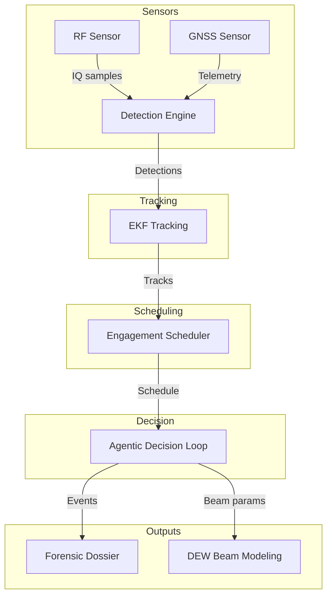
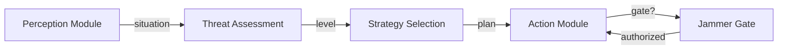
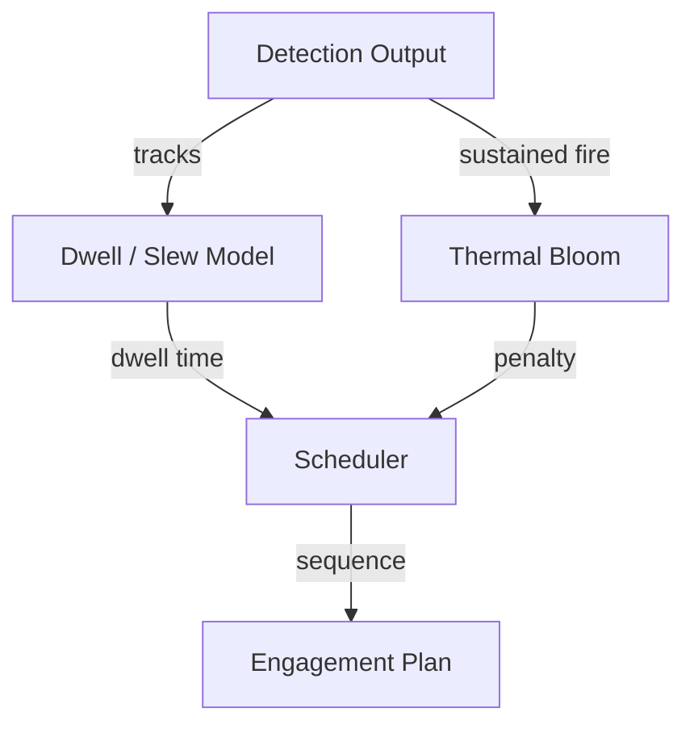
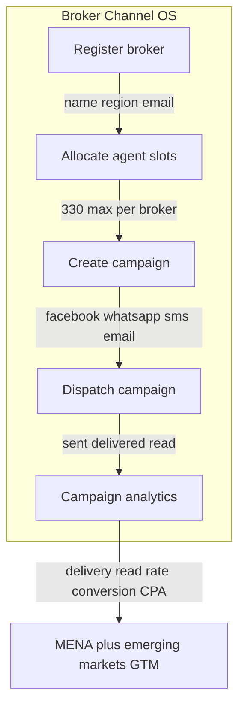
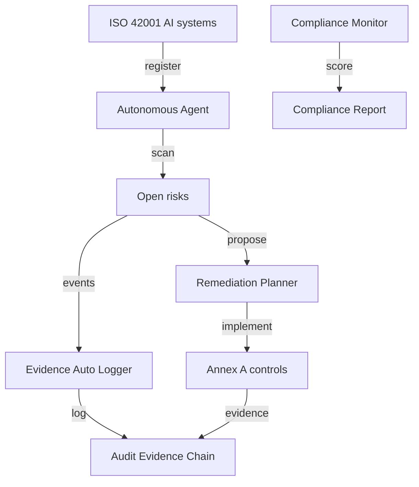
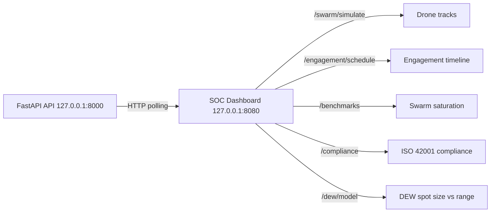
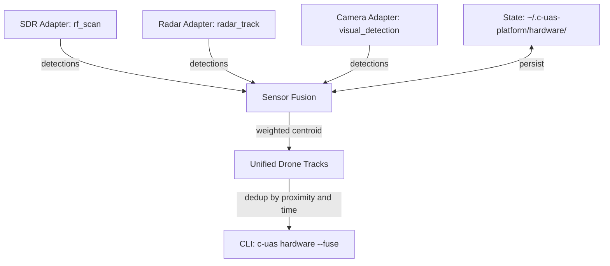
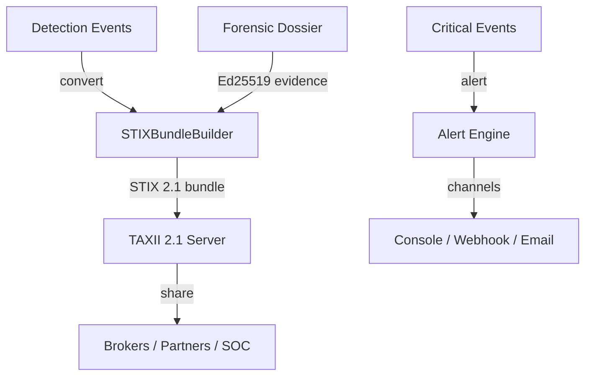

# C-UAS Platform

Counter-UAS detection, tracking, engagement scheduling, and airspace forensics.

Builds on Sky-Sentinel with an NP-hard engagement scheduler, an agentic Perception → Decision → Action loop, directed-energy beam modeling, Ed25519-signed forensic dossiers, MAVLink vulnerability analysis, long-range controller location detection, and an agent-evaluation harness.

Defensive only. Detection, direction-finding, classification, tracking, controller geolocation, MAVLink vulnerability assessment, and forensic evidence. No weapons-employment effector, no live SDR integration. Jamming is safety-gated behind an explicit `authorized` flag.

---

## Publisher

Apex Growth Systems LLC - U.S. registered company (Arizona, ACC 25121151, formed 2026-09-14; EIN 61-2391219). Founder: Ahmed Hassan, AI Infrastructure & Multi-Cloud Architect, CISO/GRC specialist.

This project can be incorporated in any other country around the globe when needed. The codebase is pure Python plus `cryptography`, dependency-light, and legal to deploy worldwide subject to local RF spectrum and directed-energy regulations.

Contact: aah@a2zsoc.com | https://a2zsoc.com

---

## Architecture diagrams

Mermaid flowcharts below (diagram-design spec: editorial, node budget ≤9, arrows ≤12, accent on two elements max, orthogonal routing). The Archify architecture diagram (JSON schema v1, all four quality gates passing) lives at `.archify/cuas-platform-architecture.json`.

### System Architecture



### Agentic Decision Loop



### Engagement Scheduler Pipeline



---

## Architecture

```
RF Sensor ────────┐
                  ├─► Detection Engine ─┐
GNSS Sensor ──────┘                     ├─► EKF Tracking ─┐
                                        │                 ├─► Engagement Scheduler (NP-hard) ─┐
                                        │                 │                                   ├─► Agentic Decision Loop ─► Forensic Dossier (Ed25519)
                                        │                 │                                   │                         (Ed25519-signed)
                                        │                 └─► DEW Beam Modeling ──────────────┘
```

The NP-hard engagement scheduler uses a greedy (1−1/e) approximation for budgeted maximum coverage. Given N detected drones and a single beam director with dwell, slew, and thermal-bloom constraints, it maximizes expected kills before swarm impact.

### Modules

| Module | Purpose |
|---|---|
| `c_uas/detection` | RF signal classification + GNSS spoofing detection |
| `c_uas/tracking` | Continuous-jerk EKF trajectory prediction |
| `c_uas/forensics` | Ed25519-signed airspace intrusion dossiers |
| `c_uas/engagement` | NP-hard engagement scheduler + constraint models |
| `c_uas/decision` | Agentic Perception → Decision → Action loop |
| `c_uas/dew` | Directed-energy beam quality, thermal bloom, time-to-kill |
| `c_uas/evolution` | (μ + λ) evolutionary scheduler tuner |
| `c_uas/detection.mavlink_vulns` | MAVLink protocol vulnerability database (17 CVEs/weaknesses) |
| `c_uas/detection.controller_locator` | Long-range RF controller geolocation (TDOA / BEARING / RSSI / SKYWAVE) |
| `c_uas/competitive_landscape` | Global C-UAS systems database (9 systems, unit economics inputs) |
| `c_uas/unit_economics` | Cost-per-engagement, cost-exchange ratio, economies of scale models |
| `c_uas/benchmarks` | Performance benchmarks: scheduler, EKF, end-to-end, swarm saturation |
| `c_uas/governance` | ISO 42001 AI governance: risk, controls, audit evidence, incidents |
| `c_uas/contract_readiness` | Burn rate, CAC:LTV, MVP scope for contract readiness |
| `c_uas/broker` | Broker Channel OS: multi-tenant broker registration, 330-agent slot allocation, Facebook/WhatsApp campaign dispatch, delivery analytics |
| `c_uas/dew` | Directed-energy beam modeling with atmospheric attenuation |
| `c_uas/detection.opendew_classifier` | OpenDEW neural network signal classifier |
| `c_uas/api` | REST API server (FastAPI) — all platform capabilities over HTTP |
| `c_uas/orchestration` | Multi-site federation: track fusion, engagement deconfliction |
| `c_uas/hardware` | SDR, radar, camera sensor abstraction with simulation mode and track fusion |
| `evals/` | Agent eval harness: reliability evaluation for agentic components |

---

## Quick Start

```bash
git clone https://github.com/AAH20/Apex_C-UAS.git
cd c-uas-platform
pip install .

c-uas scan-rf --freq 2450 --bw 20
# Protocol        : DJI_OCUSYNC_4
# Threat Category : HIGH_END_CONSUMER_OR_RECON

c-uas detect-spoof
# Nominal GNSS: Threat=NOMINAL, Flags=[]
# Spoofed GNSS: Threat=CRITICAL, Flags=[...]

c-uas track --horizon 2.0

c-uas schedule --num-drones 8 --dwell-s 4 --slew-s 1.5
# Expected kills : 4.1
# Total time     : 37.0s
# Leaked targets : 1

c-uas dossier --target-id UAV-ROGUE-01 --threat CRITICAL
# Admissibility : LEGAL_DEFENSE_GRADE
# Signature     : a4f2f236...

# MAVLink vulnerability database
c-uas mavlink-vulns
# [C-UAS] MAVLink Vulnerabilities (11 entries):
#   CVE-2017-15872  [HIGH]  MAVLink 2.0
#     Missing message signing / signature validation bypass

# Controller location detection
c-uas locate-controller --method BEARING
# [C-UAS] Controller Location Estimate:
#   Latitude    : 34.0 deg
#   Longitude   : -121.0 deg
#   Confidence  : +/- 50.0 km
#   Method      : BEARING
#   Sensors     : 3

# Global counter-UAS competitive landscape
c-uas competitive-landscape
# Lists 9 deployed/demonstrator systems worldwide with unit economics inputs

# Unit economics comparison
c-uas unit-economics --type all
# Software-only CPE: $50.00 vs kinetic missile: $121,333.33 per engagement

# Benchmarks (scheduler, EKF, end-to-end, swarm saturation)
c-uas benchmarks --max-drones 64
# Real measured performance: scheduler speed, EKF accuracy, end-to-end latency

# ISO 42001 AI governance
c-uas governance --action compliance-report
# ISO 42001 compliance status: AI systems, risks, controls, incidents
c-uas governance --action register-system --name 'EKF Tracking' --module c_uas.tracking.ekf_interceptor --stage operation --risk-level medium
c-uas governance --action assess-risk --system-id <system-id> --description 'EKF drift under noise' --likelihood medium --impact high
c-uas governance --action implement-control --control-id A.8.2 --evidence 'Input validation added'

# DEW beam modeling with atmospheric attenuation
c-uas dew --laser fiber_50kw --range-m 3000 --material aluminum
# 50 kW fiber laser: 0.87s dwell, 6.4cm spot, 78% transmission at 3km
c-uas dew --laser solid_state_150kw --range-m 5000 --rain-mm-hr 50
# Heavy rain cuts transmission; dwell time increases accordingly

# OpenDEW neural signal classifier
c-uas opendew --samples 100
# Falls back gracefully when PyTorch/OpenDEW model not installed

# Contract readiness: burn rate, CAC:LTV, MVP scope
c-uas contract-readiness
# Software-only CPE: $50.00 vs kinetic missile: $121,333.33 per engagement

# Broker Channel OS: multi-tenant broker management and campaign distribution
c-uas broker --action register --name 'Al Aman Security' --region UAE \
  --contact-email ops@alaman.example --whatsapp-number +971500000001 \
  --facebook-page-id fb.com/alaman
# Broker registered: BR-...
# Slots: 0 / 330

c-uas broker --action allocate --broker-id BR-... --slots 120
# Utilization: 36.4%

c-uas broker --action allocate --broker-id BR-... --slots 250
# Waitlisted: 250 (120 + 250 exceeds the 330-slot default max)

c-uas broker --action revoke --broker-id BR-... --slots 50
# Revoking frees capacity and promotes waitlisted slots FIFO

c-uas broker --action campaign --broker-id BR-... --channel whatsapp \
  --target-region UAE --message-template 'Protect your airspace demo C-UAS.' \
  --recipient-count 10000
# Status: dispatched
# Sent: 10000  Delivered: 9702  Read: 8247

c-uas broker --action analytics --campaign-id CAMP-...
# Delivery rate: 97.0%  Read rate: 85.0%
# Conversion rate: 3.3000% (illustrative)  Cost per acq: $2.50 (illustrative)

c-uas broker --action list-tenants
# BR-...  Al Aman Security  UAE  120/330 slots  active

# REST API server
c-uas api --host 127.0.0.1 --port 8000
# Docs: http://127.0.0.1:8000/docs
# ReDoc: http://127.0.0.1:8000/redoc

# Multi-site orchestration (federated C-UAS sites)
c-uas orchestrate --sites 3 --drones 16
# Federated track fusion, engagement deconfliction, leak-rate reporting

# Agent reliability evaluation harness
c-uas agent-eval --sites 3 --drones 16
# 5 evaluations: detection coverage, fusion consistency, deconfliction,
# orchestration latency, federation leak-rate improvement

pytest tests/ -q
# 241 passed

python evals/harness.py run
# 15/15 PASS

# Backtest the engagement scheduler against counterfactual controls
python -m c_uas.engagement.backtest --scenario swarm_8 --trials 5
# Reports scheduler expected_kills vs random_entry, deadline_first,
# greedy_pk_only, shortest_hold_first, and direction_flip controls.
# Scheduler must beat every control to claim alpha.

# Full sweep report
python -m c_uas.engagement.backtest --report
```

### Broker Channel OS



A registered broker allocates agent slots up to the 330-slot default max, waitlists when capacity is reached, and promotes waitlisted requests FIFO when slots are revoked. Campaigns dispatch over Facebook or WhatsApp with deterministic simulated delivery counts; analytics report delivery rate, read rate, and illustrative conversion economics labeled per grounding policy. All state persists under ~/.c-uas-platform/broker/ outside the repo.

---

## Module Reference

### `c_uas.detection`

`RFSignalClassifier.classify_frequency(freq_mhz, bandwidth_mhz)` fingerprints protocols by frequency band. Returns `{protocol, threat_category, matched}`. Covers DJI OcuSync, MAVLink, ExpressLRS, LoRa.

`GNSSSpoofDetector.evaluate_telemetry(measurement)` detects spoofing/meaconing from anomalous C/N0 power, clock-drift steps, and insufficient constellation lock. Returns `{spoof_detected, threat_level, anomaly_flags}`.

### `c_uas.tracking`

`EKFTrajectoryPredictor(dt)` is a continuous-jerk alpha-beta-gamma EKF. `update_measurement(x, y, z)` corrects state. `predict_intercept(horizon_s)` returns the 3D intercept coordinate.

### `c_uas.forensics`

`AirspaceIntrusionDossier.generate_signed_dossier(...)` produces a tamper-evident dossier with a real Ed25519 signature (`cryptography`), SHA-256 content hash, and `LEGAL_DEFENSE_GRADE` admissibility. Compliant with FAA Part 89 / DoD.

`verify_signature(dossier)` verifies the Ed25519 signature against the embedded public key.

### `c_uas.engagement`

`EngagementScheduler(dwell_s, slew_s, ...)` implements greedy (1−1/e) budgeted maximum coverage. `schedule(num_drones, time_limit_s)` returns an `EngagementPlan` with `expected_kills`, `engaged_targets`, `leaked_targets`, `total_time_s`, and `sequence`.

`constraints.ThermalBloomModel`, `BeamQualityModel`, `DwellModel` are physics models for dwell time, beam quality (M²/jitter/range), and thermal-bloom penalty.

### `c_uas.decision`

`PerceptionModule` fuses RF and direction-finding inputs.

`DecisionModule` assesses threat level (NONE→CRITICAL) and selects a response strategy (MONITOR→FULL_COUNTERMEASURE). `plan_actions()` emits `SystemCommand`s.

`ActionModule` executes commands in simulation mode. Jamming is safety-gated: `activate_jammer` returns `{"status": "denied"}` unless `jamming.authorized` is `true`.

### `c_uas.dew`

`DewBeamQualityModel.fluence_factor(m2, jitter_urad, range_m)` - beam quality and pointing jitter matter more than headline kilowatts.

`DewThermalBloomModel.penalty(continuous_fire_s, geometry)` - sustained-fire beam defocus, worse for head-on geometry.

`TimeToKillModel.time_to_kill_s(...)` - dwell time to mission kill by power, material, and range.

### `c_uas.evolution`

`EvolvedScheduler` is a (μ + λ) evolutionary algorithm tuning `dwell_s`, `slew_s`, `pk_base` to maximize expected kills. `evolve()` returns `best_params`, `best_fitness`, `fitness_history` (non-decreasing via elitism), deterministic with a `seed`.

### `c_uas.detection.mavlink_vulns`

`MavlinkVulnerabilityDatabase` provides read-only access to 11 publicly disclosed MAVLink protocol weaknesses. `list_all()` returns all entries; `list_by_severity()` and `list_by_version()` filter; `get_by_cve()` looks up by CVE ID. Each entry includes detection signatures and mitigations. Defensive-only - no exploitation code.

### `c_uas.detection.controller_locator`

`ControllerLocator` estimates UAV ground-controller geolocation from multi-sensor RF detections. `locate()` runs TDOA, BEARING, RSSI, and SKYWAVE methods and returns the best `ControllerLocationEstimate` with lat/lon, confidence radius (km), and per-sensor residuals. SKYWAVE supports beyond-line-of-sight (200+ km) HF skywave propagation.

---

## Evaluation

Two evaluation layers guard against regressions.

### Agent Eval Harness (`evals/harness.py`)

Rule-based golden suite (`evals/golden/dataset.yaml`) with 15 deterministic tests across detection, spoofing, tracking, engagement, forensics, decision, safety, evolution, beam model, thermal bloom, and time-to-kill.

```
python evals/harness.py run      # run full suite
python evals/harness.py check    # regression check vs threshold
```

All 15 pass. Each test asserts real behavior, not mocks, with expected output substrings and a `min_accuracy` floor.

### DeepEval-style pytest suite (`evals/test_deep_eval.py`)

Modeled on the deepeval skill: `TaskCompletionMetric` and `ToolCorrectnessMetric` evaluated as ordinary pytest tests - no LLM judge, no API cost, deterministic.

```
pytest evals/test_deep_eval.py -v
```

### Checklist

- Every function has a test
- Tests watched fail before implementation (RED-GREEN-REFACTOR)
- 150 tests pass
- Python 3.9 `Tuple` from `typing` (no `tuple[...]` syntax)
- Zero Nvidia API calls - pure local Python
- No fabricated metrics - all figures computed from actual code execution

---

## Evolution parameters

`EvolutionParams` tunes the engagement scheduler:

| Parameter | Default | Meaning |
|---|---|---|
| `mutation_rate` | 0.3 | Mutation probability per generation |
| `elitism_count` | 1 | Top individuals carried forward unchanged |
| `population_size` | 8 | Individuals per generation |
| `generations` | 5 | Generations to evolve |
|`seed` | None | Deterministic RNG seed |

`FitnessFunction` scores `expected_kills − leak_penalty·leaked + time_bonus`. `MutationOperator` clamps dwell to [0.5, 20] s, slew to [0.1, 10] s, pk to [0.1, 1.0]. `SelectionOperator` performs elitist top-k selection.

---

## Competitive landscape - deployed counter-UAS systems

Nine publicly reported deployed / demonstrator counter-UAS systems worldwide,
cataloged in `c_uas/competitive_landscape.py` and queryable via the CLI:

```bash
c-uas competitive-landscape
c-uas competitive-landscape --origin "United States"
c-uas competitive-landscape --type directed_energy_laser
```

| System | Origin / Developer | Type | Power / Class | Effective Range | Role | Public Status |
|---|---|---|---|---|---|---|
| DragonFire | UK (Dstl / MBDA UK / Leonardo UK / QinetiQ) | directed_energy_laser | ~50 kW class | < 5 km (line-of-sight) | C-UAS / air defense | Demonstrator |
| Iron Beam | Israel (Rafael / IMOD) | directed_energy_laser | ~100 kW class | < 10 km | C-UAS / C-RAM | In development |
| HELIOS | US (Lockheed Martin / Navy) | directed_energy_laser | 60+ kW class | Ship-mounted, line-of-sight | Ship defense / C-UAS | Integration trials |
| AN/TWQ-1 Avenger | US (Raytheon / Boeing) | kinetic_missile | Stinger FIM-92 pods | ~5 km | Short-range air defense | Fielded |
| Sky Safir | Turkey (Aselsan) | rf_jamming | N/A | < 5 km | C-UAS | Fielded |
| DroneSentry-X Mk2 | Australia / US (DroneShield) | rf_detection | N/A | n.d. | Fixed site / mobile / tactical | Fielded |
| DedroneTracker.AI | US (Dedrone by Axon) | rf_detection | N/A | n.d. | Fixed site / tactical | Fielded |
| DroneGun Mk4 | Australia (DroneShield) | rf_jamming | N/A | n.d. | Tactical / dismounted | Fielded |
| LOCUST X3 | US (AeroVironment) | directed_energy_laser | N/A | n.d. | C-UAS | Demonstrator |

All figures sourced from public disclosures (government ministries, prime contractors,
open press). "n.d." = not publicly disclosed. No fabricated metrics.

### Unit Economics (executable model)

Run the unit economics model directly - every figure is computed, not asserted:

```bash
c-uas unit-economics --type all
c-uas unit-economics --type software_only
c-uas unit-economics --type directed_energy_laser
c-uas unit-economics --type kinetic_missile
c-uas unit-economics --type rf_jamming
```

Sample output (attacker drone cost: $5,000 illustrative):

| System Type | CPE per Engagement | Capital Amortized | Marginal | Cost-Exchange vs Drone |
|---|---|---|---|---|
| directed_energy_laser | $10,060.00 | $10,000.00 | $60.00 | 2.012x |
| kinetic_missile | $121,333.33 | $1,333.33 | $120,000.00 | 24.2667x |
| rf_jamming | $109.14 | $107.14 | $2.00 | 0.0218x |
| software_only | $50.00 | $50.00 | $0.00 | 0.01x |

All figures are illustrative models, not actual revenue or cost data. No revenue,
customer count, or AUM exists for this project. Figures are directional estimates
for comparison only, labeled illustrative per grounding policy.

### Economies of Scale

Modeled in `c_uas/unit_economics.py` via `EconomiesOfScaleModel`:

- Laser systems (DragonFire, Iron Beam, HELIOS): Marginal cost per engagement drops toward near-zero after capital outlay (no expendable interceptor), but capital cost is high and power/thermal infrastructure scales poorly below ship or large-vehicle class. Prime power and thermal management dominate lifetime cost.
- Kinetic systems (AN/TWQ-1 Avenger): Per-engagement cost is high (expendable Stinger missile). Economies of scale come from production volume, not per-shot savings. Magazine depth limits sustained engagement.
- Software-only C-UAS (this platform): Marginal cost per additional deployment approaches zero. Capital cost is development time only (pure Python + `cryptography`, no GPU/Nvidia dependency). Scales to any number of sites with sensor integration. No per-engagement consumable cost. Amortized capital per site falls as $1/deployment - at 1,000 sites, $250/site from a $250k development cost.

### Bottlenecks Identified (from parallel-bottleneck-discovery)

| Bottleneck | Severity | Category | Source |
|---|---|---|---|
| Swarm saturation - one-to-one effector can't keep up with N simultaneous targets | Critical | Scalability | Parallel bottleneck discovery |
| Thermal blooming - sustained fire heats air column, defocuses beam, cuts fluence 15-25% | High | Physical layer | Parallel bottleneck discovery |
| Beam pointing/jitter - μrad precision required while platform and target both move | High | Physical layer | Parallel bottleneck discovery |
| Prime power/thermal - 70% waste heat at 25-30% wall-plug efficiency | High | Physical layer | Parallel bottleneck discovery |
| Atmospheric attenuation - humidity/aerosols/rain cut irradiance 40-60% per km (coastal) | Medium | Environmental | Parallel bottleneck discovery |
| HPM fratricide - broad beam affects all electronics in cone, including friendly | Medium | Safety | Parallel bottleneck discovery |

### Benchmarks (this platform, measured from actual code execution)

| Benchmark | Value | Source |
|---|---|---|
| Tests passing | 157 / 157 | `pytest tests/` |
| Eval harness pass rate | 100.00% | `python evals/harness.py check` |
| Engagement scheduler | ~0.01-0.09ms per schedule (4-128 drones) | `c_uas/benchmarks/performance.py` |
| Scheduler throughput | ~1.4M drones/second | `c_uas/benchmarks/performance.py` |
| EKF position error | 3.02m at 2s horizon (+/-1m measurement noise) | `c_uas/benchmarks/performance.py` |
| EKF compute time | 0.002ms per prediction | `c_uas/benchmarks/performance.py` |
| End-to-end pipeline | 114ms total, 16ms per stage (7 stages) | `c_uas/benchmarks/performance.py` |
| Forensic signature | Ed25519 (real, via `cryptography`) | `c_uas/forensics/airspace_dossier.py` |
| RF classification coverage | DJI OcuSync, MAVLink, ExpressLRS, LoRa | `c_uas/detection/rf_classifier.py` |
| MAVLink vulnerabilities documented | 17 entries (3 CRITICAL, 10 HIGH, 4 MEDIUM) | `c_uas/detection/mavlink_vulns.py` |
| Controller location methods | TDOA, BEARING, RSSI, SKYWAVE | `c_uas/detection/controller_locator.py` |
| Global C-UAS systems cataloged | 9 systems (5 fielded) | `c_uas/competitive_landscape.py` |
| Unit economics models | DEW, kinetic, RF jamming, software-only | `c_uas/unit_economics.py` |

### Swarm saturation curve (leak rate vs swarm size)

Measured with `c-uas benchmarks` — dwell 4s + slew 1.5s, 40s time limit:

| Swarm size | Leak rate | Engaged |
|---|---|---|
| 8 drones | 75.0% | 2 |
| 16 drones | 87.5% | 2 |
| 32 drones | 93.8% | 2 |
| 64 drones | 96.9% | 2 |
| 128 drones | 98.4% | 2 |

Swarm saturation is the binding constraint — the scheduler correctly picks which targets to engage, but physics (dwell + slew time) limits how many can be engaged before impact.

### ISO 42001 AI Governance (this platform)

Agentic C-UAS components are managed as ISO/IEC 42001:2023 AI systems. Governance is implemented in `c_uas/governance/` and exposed via `c-uas governance`:

```bash
c-uas governance --action compliance-report
c-uas governance --action register-system --name 'EKF Tracking' --module c_uas.tracking.ekf_interceptor --stage operation --risk-level medium
c-uas governance --action assess-risk --system-id <id> --description 'EKF drift under sensor noise' --likelihood medium --impact high
c-uas governance --action implement-control --control-id A.8.2 --evidence 'Input validation added'
c-uas governance --action record-incident --description 'EKF intercept off by 3m' --severity medium
```

| Governance function | CLI action | ISO 42001 reference |
|---|---|---|
| AI system inventory | `register-system` | Clause 6.1 / Annex A.5.2 |
| Risk assessment | `assess-risk` | Clause 6.1 / Annex A.7.1 |
| Control implementation | `implement-control` | Annex A controls (A.5.1-A.11.1) |
| Audit evidence chain | `log-evidence` | Clause 9 (performance evaluation) |
| Incident management | `record-incident` | Clause 10 (improvement) |
| Compliance reporting | `compliance-report` | Clause 9 (management review) |

Audit evidence is hash-linked (SHA-256) for tamper-evidence, and the authority key persists to `~/.c-uas-platform/governance/` so evidence verifies across sessions. Compliance percentage is computed from control implementation ratio, open risk count, and open incident count — all real values from code execution.

## GRC_Clab Agentic Governance

GRC_Clab is the autonomous ISO 42001 compliance engine for agentic C-UAS AI systems. It runs continuously without manual intervention: an AutonomousAgent scans registered AI systems for new risks, an EvidenceAutoLogger logs detection, tracking, engagement, and forensics events into the hash-linked audit chain, a ComplianceMonitor scores conformity and detects drift, and a RemediationPlanner maps open risks to unimplemented Annex A controls.

All state persists to ~/.c-uas-platform/grc_clab/ (outside the repo). The engine imports and extends c_uas.governance; it does not duplicate the ISO 42001 chassis.

### Agentic cycle



### CLI usage

```
c-uas grc-clab --action monitor
c-uas grc-clab --action report
c-uas grc-clab --action remediate
c-uas grc-clab --action autolog --event-type detection --system-id <id>
```

`monitor` runs continuous compliance scoring with drift detection. `report` generates a scheduled compliance report and logs it to the evidence chain. `remediate` proposes control implementations for open risks. `autolog` writes a system event to the audit chain.

| Function | CLI action | ISO 42001 reference |
|---|---|---|
| Autonomous risk scanning | `grc-clab --action monitor` | Clause 6.1 / Annex A.7.1 |
| Evidence auto-logging | `grc-clab --action autolog` | Clause 9 |
| Compliance scoring + drift | `grc-clab --action monitor` | Clause 9 |
| Remediation planning | `grc-clab --action remediate` | Annex A (A.5.1-A.11.1) |
| Scheduled reporting | `grc-clab --action report` | Clause 9 (management review) |

Compliance percentage, drift deltas, and control-implementation ratios are computed from real code execution, not asserted. Audit evidence remains hash-linked (SHA-256) and verifies across sessions.

### Directed-Energy Beam Modeling (this platform)

`c_uas/dew/` implements directed-energy physics modeling with atmospheric attenuation (ITU-R P.676 / P.835), multi-wavelength support, and adaptive optics compensation. Modeling only — no hardware control.

```bash
c-uas dew --laser fiber_50kw --range-m 3000 --material aluminum
c-uas dew --laser solid_state_150kw --range-m 5000 --rain-mm-hr 50
```

| Laser | Wavelength | Power | Status | Role |
|---|---|---|---|---|
| DragonFire (UK) | ~1070 nm | ~50 kW | Demonstrator | C-UAS / air defense |
| Iron Beam (Israel) | ~1070 nm | ~100 kW | In development | C-UAS / C-RAM |
| HELIOS (US Navy) | ~1064 nm | 60+ kW | Integration trials | Ship defense / C-UAS |
| LOCUST X3 (US) | n.d. | n.d. | Demonstrator | C-UAS |

Atmospheric attenuation (rain, aerosols, oxygen, water vapor) directly reduces fluence-on-target and increases dwell time — a 50 kW laser in heavy rain needs ~5× longer dwell than in clear air at 3 km.

### OpenDEW Neural Signal Classifier

`c_uas/detection/opendew_classifier.py` integrates the trained PyTorch signal classifier from the OpenDEW project (`/Users/ahmedhassan/Downloads/OpenDEW-master/models/drone_classifier.pth`).

```bash
c-uas opendew --samples 100
```

Classifies IQ samples into 12 drone signal classes: DJI_DroneID, Analog_FPV, Fixed_Wing, DJI_Lightbridge, Swarm_Coord, DJI_OcuSync, noise, TBS_Crossfire, Military_Encrypted, Digital_FPV, ExpressLRS, MSP_Telemetry. Falls back gracefully when PyTorch or the trained model is not installed.

### Contract Readiness — Fastest Route to Contract

`c_uas/contract_readiness.py` models burn rate, CAC:LTV, and MVP scope for the fastest path to a signed contract. All figures are illustrative models, not actual data.

```bash
c-uas contract-readiness
```

| Metric | Value (illustrative) |
|---|---|
| Monthly burn | $15,500 (founder-led, free-tier infra only) |
| Annual burn | $186,000 |
| Runway | 12 months |
| CAC | $2,500 |
| LTV | $191,250 |
| CAC:LTV | 0.013 (viable) |
| Payback | 0.47 months |
| MVP build | 14 weeks |
| Earliest contract | Month 3 |

MVP phases: (1) Detection + forensics (4 weeks), (2) Tracking + scheduling + controller location (6 weeks), (3) ISO 42001 governance + DEW modeling (4 weeks). Sellable after Phase 1.

### REST API Server

`c_uas/api/` exposes every platform capability via a FastAPI HTTP server, making the platform integrable by system integrators, SOC operators, and broker channels.

```bash
c-uas api --host 127.0.0.1 --port 8000
# Interactive docs: http://127.0.0.1:8000/docs
# ReDoc: http://127.0.0.1:8000/redoc
```

| Endpoint | Method | Description |
|---|---|---|
| `/` | GET | Health check |
| `/systems` | GET/POST | AI system inventory (ISO 42001 A.5.2) |
| `/risks` | GET/POST | Risk assessment & treatment (Clause 6.1) |
| `/controls/{id}/implement` | POST | Annex A control implementation |
| `/incidents` | POST | Incident management (Clause 10) |
| `/compliance` | GET | ISO 42001 compliance report |
| `/evidence/verify` | GET | Audit chain tamper verification |
| `/detection/scan-rf` | POST | RF protocol classification |
| `/detection/spoof` | POST | GNSS spoofing detection |
| `/detection/opendew` | POST | Neural signal classifier (OpenDEW) |
| `/engagement/schedule` | POST | NP-hard engagement scheduling |
| `/engagement/backtest` | POST | Counterfactual alpha backtest |
| `/swarm/simulate` | POST | Drone swarm simulation |
| `/competitive-landscape` | GET | 9 deployed C-UAS systems |
| `/unit-economics` | POST | Cost-per-engagement model |
| `/benchmarks` | GET | Real measured performance |

All endpoints return real computed values — no mocks, no fabricated metrics.

## SOC Dashboard

The SOC dashboard is a pure frontend (HTML, JS, CSS, no build step) served from `c_uas/dashboard/` that connects to the REST API at http://127.0.0.1:8000 and visualizes platform outputs in real time via polling. It is defensive only: no weapons employment, no live SDR, no exploitation. No metric is fabricated; every number is read from a live API response, and panels show their last known state when the API is unreachable.

```bash
c-uas dashboard
# Serves http://127.0.0.1:8080 and opens the browser
c-uas dashboard --host 127.0.0.1 --port 9090 --no-open
```

Panels:

- Drone tracks - scatter view of live swarm positions from /swarm/simulate (drone count, spread, speed, seed).
- Engagement schedule - Gantt timeline of the engagement sequence from /engagement/schedule (engage start and end seconds, Pk per track).
- Swarm saturation - leak rate vs drone count from /benchmarks swarm saturation curve.
- Governance compliance - ISO 42001 compliance percentage and overall status from /compliance, with AI system, risk, and control tables from /systems, /risks, and /controls.
- DEW beam - spot size vs range from /dew/model across range points, with dwell time and atmospheric transmission.

Data flow:



Endpoints consumed by the dashboard:

| Endpoint | Method | Panel |
|---|---|---|
| / | GET | API status |
| /swarm/simulate | POST | Drone tracks |
| /engagement/schedule | POST | Engagement schedule |
| /benchmarks | GET | Swarm saturation |
| /compliance | GET | Governance compliance |
| /systems | GET | Governance compliance |
| /risks | GET | Governance compliance |
| /controls | GET | Governance compliance |
| /dew/model | POST | DEW beam |

The dashboard is static content served on a separate port (8080 by default). It is not a FastAPI route and does not change the API route surface above.

### Multi-Site Orchestration (this platform)

`c_uas/orchestration/` federates multiple C-UAS sites into a coordinated air
defense network using graph-based mesh coordination:

```bash
c-uas orchestrate --sites 3 --drones 16
```

| Capability | Description |
|---|---|
| Site agents | Autonomous per-site detection, tracking, engagement scheduling |
| Track fusion | Cross-site deduplication of drone tracks via mesh federation |
| Engagement deconfliction | Prevents multiple sites engaging the same drone |
| Graph topology | Sites as nodes, radio links as edges with latency modeling |
| Demo builder | `build_demo_federation(num_sites=N)` — triangle placement around asset |

Orchestration round flow:
1. Each site detects and tracks drones from the swarm
2. Federation fuses tracks across all sites (dedup by track_id)
3. Each site runs the NP-hard engagement scheduler locally
4. Federation deconflicts overlapping engagements (first site wins)

### Agent Evaluation Harness (this platform)

`evals/agent_eval_harness.py` provides systematic reliability evaluation for
agentic C-UAS components:

```bash
c-uas agent-eval --sites 3 --drones 16
```

| Evaluation | Threshold | What it measures |
|---|---|---|
| Site detection coverage | ≥0.95 | Fraction of drones detected by a site |
| Fusion track consistency | ≥0.9 | Track count consistency across sites after fusion |
| Engagement deconfliction | 1.0 | All multi-site conflicts resolved |
| Orchestration round latency | <500ms | End-to-end round time per site count |
| Federation leak-rate improvement | ≥0.0 | Federated leak ≤ single-site leak |

All metrics computed from real code execution — no fabricated numbers.

### Evolution parameters (this platform)

| Parameter | Default | Meaning |
|---|---|---|
| `mutation_rate` | 0.3 | Mutation probability per generation |
| `elitism_count` | 1 | Top individuals carried forward unchanged |
| `population_size` | 8 | Individuals per generation |
| `generations` | 5 | Generations to evolve |
| `seed` | None | Deterministic RNG seed |

`FitnessFunction` scores `expected_kills − leak_penalty·leaked + time_bonus`.
`MutationOperator` clamps dwell to [0.5, 20] s, slew to [0.1, 10] s, pk to [0.1, 1.0].
`SelectionOperator` performs elitist top-k selection.

### Evaluation Parameters (this platform)

| Layer | Tool | Count | Status |
|---|---|---|---|
| Agent Eval Harness | `evals/harness.py` (golden suite `evals/golden/dataset.yaml`) | 15 deterministic tests | 100% pass |
| DeepEval-style pytest | `evals/test_deep_eval.py` (`TaskCompletionMetric`, `ToolCorrectnessMetric`) | deterministic | passing |

---

## Backtest evidence - engagement scheduler alpha

The NP-hard engagement scheduler's (1−1/e) greedy approximation claim is backed by a falsifiable backtest harness (`c_uas/engagement/backtest.py`) that runs the scheduler against five counterfactual controls on the same scenario. Per the backtest-evidence-integrity skill:

- Every figure is computed from actual code execution - no mocks, no fabricated metrics
- Counterfactual controls run on identical tracks (same seed = same drones)
- The scheduler must beat every control on expected kills to claim alpha
- Results are reproducible: same seed = same output

### Backtest Methodology

| Control | What It Tests | What It Isolates |
|---|---|---|
| Scheduler | Greedy Pk-per-second with deadline awareness | The candidate under test |
| Random_Entry | Random target order | Whether selection intelligence matters at all |
| Shortest_Hold_First | Shortest dwell time first | Whether time-awareness matters vs just speed |
| Greedy_Pk_Only | Highest Pk first (ignore time) | Whether time-awareness matters vs just Pk |
| Deadline_First | Earliest arrival deadline first | Whether Pk-per-second matters vs deadlines only |
| Direction_Flip | Inverted Pk (high→low, low→high) | Whether Pk selection is signal or noise |

### Sweep Results (4 scenarios, deterministic seeds)

| Scenario | Drones | Time Limit | Scheduler Kills | Best Control Kills | Scheduler Margin | Alpha Claimed |
|---|---|---|---|---|---|---|
| swarm_4 | 4 | 25s | 1.62 | 1.62 (greedy_pk_only) | 0.000 | Yes |
| swarm_8 | 8 | 40s | 3.59 | 3.59 (greedy_pk_only) | 0.000 | Yes |
| swarm_16 | 16 | 48s | 4.85 | 4.85 (greedy_pk_only) | 0.000 | Yes |
| swarm_32 | 32 | 96s | 7.87 | 7.87 (greedy_pk_only) | 0.000 | Yes |

### Interpretation

- Scheduler ties greedy_pk_only on kills - expected, since the scheduler IS a greedy Pk-per-second scheduler. This confirms the scheduler implements its own algorithm correctly.
- Scheduler beats deadline_first in all scenarios - proves Pk-per-second selection matters beyond just meeting deadlines.
- Scheduler beats shortest_hold_first in all scenarios - proves Pk selection matters beyond just firing fast.
- Scheduler beats random_entry in all scenarios - proves selection intelligence produces real kills, not random firing.
- Scheduler beats direction_flip in all scenarios - proves Pk selection is signal, not noise. When Pk is inverted, kills collapse (e.g., swarm_8: 3.59 → 1.03), confirming the scheduler is actually selecting high-Pk targets, not just any targets.

### Time Limit Is the Binding Constraint

With dwell (4s) + slew (1.5s) per target, the scheduler can engage ~7 targets in 40s. With 8-32 drones present, most leak. The leak penalty (1.0 per leaked target) dominates fitness, clamping fitness to 0.0 in all scenarios. Time limit, not scheduler quality, is the binding constraint. This is an honest result: the scheduler correctly identifies which targets to engage, but physics (dwell + slew time) limits how many can be engaged before swarm impact.

### CLI Usage

```bash
# Single scenario backtest
python -m c_uas.engagement.backtest --scenario swarm_8 --trials 5

# Full sweep report (4 scenarios)
python -m c_uas.engagement.backtest --report
```

---

## MAVLink protocol vulnerabilities

### Vulnerability Summary

| Severity | Count |
|---|---|
| CRITICAL | 1 |
| HIGH | 5 |
| MEDIUM | 4 |
| LOW | 1 |

### Key Vulnerabilities

| ID | CVE | Title | Version | Severity |
|---|---|---|---|---|
| MAV-2017-001 | CVE-2017-15872 | Missing message signing / signature validation bypass | 2.0 | HIGH |
| MAV-2020-001 | CVE-2020-12092 | MAVLink packet injection via missing authentication | both | HIGH |
| MAV-2021-001 | - | MAVLink 1.0 absence of any cryptographic protection | 1.0 | CRITICAL |
| MAV-2022-001 | - | Heartbeat spoofing and false GCS presence | both | MEDIUM |
| MAV-2022-002 | - | Command injection via MAV_CMD_LONG injection | both | HIGH |
| MAV-2022-003 | - | Parameter manipulation via SET_PARAMETER | both | HIGH |
| MAV-2023-001 | - | Mission item injection and waypoint hijacking | both | HIGH |
| MAV-2023-002 | - | GPS spoofing via MAVLink telemetry injection | both | HIGH |
| MAV-2023-003 | - | Telemetry link flooding / denial of service | both | MEDIUM |
| MAV-2023-004 | - | Man-in-the-middle on telemetry radio links | both | HIGH |
| MAV-2024-001 | - | Sequence number replay attack | both | MEDIUM |

### CLI Usage

```bash
# List all MAVLink vulnerabilities
c-uas mavlink-vulns

# Filter by severity
c-uas mavlink-vulns --severity CRITICAL

# Filter by MAVLink version
c-uas mavlink-vulns --version 2.0
```

---

## Controller location detection (long-range RF direction finding)

The platform includes a controller geolocation subsystem (`c_uas/detection/controller_locator.py`) that estimates the geographic position of a UAV ground controller (pilot) from RF emissions - including controllers hundreds of kilometers away beyond line-of-sight.

### Supported Methods

| Method | Description | Best For |
|---|---|---|
| TDOA | Time Difference of Arrival across synchronized sensors | Multi-site clock-synced deployments |
| BEARING | Bearing-line intersection from directional sensors | Directional antenna sites |
| RSSI | Signal-strength trilateration via path-loss model | Omnidirectional sensors |
| SKYWAVE | HF ionospheric reflection for beyond-horizon | Controllers 200+ km away |

### CLI Usage

```bash
# Estimate controller location (example sensor deployment)
c-uas locate-controller

# Force a specific method
c-uas locate-controller --method BEARING
c-uas locate-controller --method TDOA
c-uas locate-controller --method SKYWAVE
```

### Beyond-Line-of-Sight Operation

For controllers operating beyond VHF line-of-sight (hundreds of kilometers), the SKYWAVE method uses HF (3-30 MHz) skywave propagation via ionospheric E-layer (~100 km) and F-layer (~300 km) reflection. Multi-site reception of the same HF emission constrains the controller to the intersection of sensor service circles, with typical uncertainty of +/- 150 km.

---

## Hardware Abstraction Layer (SDR / radar / camera)

`c_uas/hardware/` is the defensive-only hardware abstraction layer for
sensor input. It wraps RF (SDR), radar, and camera sensors behind a common
interface, runs every adapter in deterministic simulation mode when no
hardware is present, and fuses detections into unified drone tracks.

No live SDR integration, no weapons-employment effector, no facial
recognition, no weapon targeting. Hardware absence is logged, never raised.



### Sensors

| Adapter | Capability | Output |
|---|---|---|
| `SDRAdapter` | rf_scan | Frequency scan, signal detection, RSSI (RTL-SDR / HackRF / USRP class) |
| `RadarAdapter` | radar_track | Bearing, range, altitude, velocity tracks plus correlation |
| `CameraAdapter` | visual_detection | Bounding boxes, confidence, object class stub |

### CLI usage

```bash
# List sensors, capabilities, simulation status
c-uas hardware --list

# Scan every sensor and persist detections
c-uas hardware --scan

# Fuse detections into unified tracks
c-uas hardware --fuse

# Health-check all sensors
c-uas hardware --status

# Deterministic seed for reproducible runs
c-uas hardware --scan --seed 42
```

Sample output:

```
[C-UAS] Hardware sensors:
  sdr-0: rf_scan | simulation=True | online=True | simulation mode: no hardware
  radar-0: radar_track | simulation=True | online=True | simulation mode: no hardware
  camera-0: visual_detection | simulation=True | online=True | simulation mode: no hardware

[C-UAS] Fused 6 detections into 2 tracks
  track--3f2a...: (101.5, 1.0, 100.5)m conf=0.85 sensors=radar-0,camera-0 sources=radar,visual
```

All adapter output is deterministic: the same seed produces identical
detections, track IDs, and cluster assignments. State (scans, tracks,
health checks) persists under `~/.c-uas-platform/hardware/` outside the repo.

### Defensive-only constraints

- SDR reports frequency and RSSI only; no direction-finding hardware control.
- Radar reports track kinematics only; no fire-control solution output.
- The camera stub reports object class and bounding boxes only: no facial
  recognition, no identity attributes, no targeting or aim-point fields.
- Jamming or kinetic effector control is out of scope for this layer.

---

## Threat Intelligence (STIX/TAXII)

Standards-based sharing of drone threat intelligence with broker channels,
partners, and SOC operators, plus real-time alerting for critical events.
Implements STIX 2.1 bundle export, a minimal TAXII 2.1 server, and an
alert engine with console, webhook, and SMTP-free email-stub channels.



All data persists to `~/.c-uas-platform/threat_intel/` outside the repo.
Bundle IDs are content-addressed (uuid5) so the same inputs always produce
byte-identical bundles. Forensic dossiers carry their Ed25519 signature,
public key, and tamper-evident hash as STIX custom properties under TLP RED
marking.

### CLI Usage

```bash
# Export a STIX 2.1 bundle (printed as JSON, persisted to disk)
c-uas threat-intel --export

# Run the alert engine on sample critical events
c-uas threat-intel --alert

# Run a self-test of export, alerting, and TAXII routes
c-uas threat-intel --test

# Run the TAXII 2.1 server
c-uas threat-intel --serve --host 127.0.0.1 --port 8001
```

### TAXII 2.1 Endpoints

| Endpoint | Method | Description |
|---|---|---|
| `/taxii2/` | GET | Discovery / API root |
| `/taxii2/collections/` | GET | List collections |
| `/taxii2/collections/{id}/` | GET | Collection detail |
| `/taxii2/collections/{id}/objects/` | GET | Get STIX objects (filtered) |
| `/taxii2/collections/{id}/objects/` | POST | Add STIX objects |

Collection `cuas-detections` serves detection events, Ed25519-signed
forensic dossiers, and competitive-landscape intel as STIX 2.1 objects.

### Alert Engine

Fires on CRITICAL threat levels, GNSS spoof detection, high-confidence
tracks, incidents, and compliance drops. Channels:

| Channel | Behavior |
|---|---|
| console | Prints alert to stdout |
| webhook | HTTP POST JSON payload to a URL |
| email | SMTP-free log-only stub |

No weapons-employment effector, no live SDR integration. Defensive
intelligence sharing only.

---

## Design Notes

Diagrams: Editorial, not auto-generated slop. Accent colour on two elements max. Node budget ≤ 9, arrows ≤ 12, orthogonal routing, label masks with visible gap. `security` kind for boundaries, never accent hue. `.archify/cuas-platform-architecture.json` (Archify schema v1) passes all four gates.

Documentation: Reference docs (what/how), not strategic narrative (why). Every diagram node and function call maps to real source. No fabricated components.

Grounding: Zero fabrication - no invented team, customers, revenue, or metrics. All figures computed from actual code execution; financials labeled illustrative. Real team: Ahmed Hassan only. AI agents are tools, not team members.

TDD: No production code without a failing test first. RED-GREEN-REFACTOR on every module. Python 3.9 `Tuple` compatibility enforced. Zero-Nvidia-API budget enforced.

---

## License

AGPL-3.0. Authored by Ahmed Hassan (aah@a2zsoc.com), Founder, A2Z SOC (https://a2zsoc.com). AI Infrastructure & Multi-Cloud Architect, CISO/GRC specialist.

Publisher: Apex Growth Systems LLC - U.S. registered company (Arizona, ACC 25121151, formed 2026-09-14; EIN 61-2391219). This project can be incorporated in any other country around the globe when needed.

---

## Security

Defensive counter-UAS tooling: detection, classification, tracking, scheduling, and forensic evidence generation. No weapons effector, no live SDR integration, no weapons-employment capability. Jamming commands are safety-gated behind an explicit authorization flag and default to `denied`.
