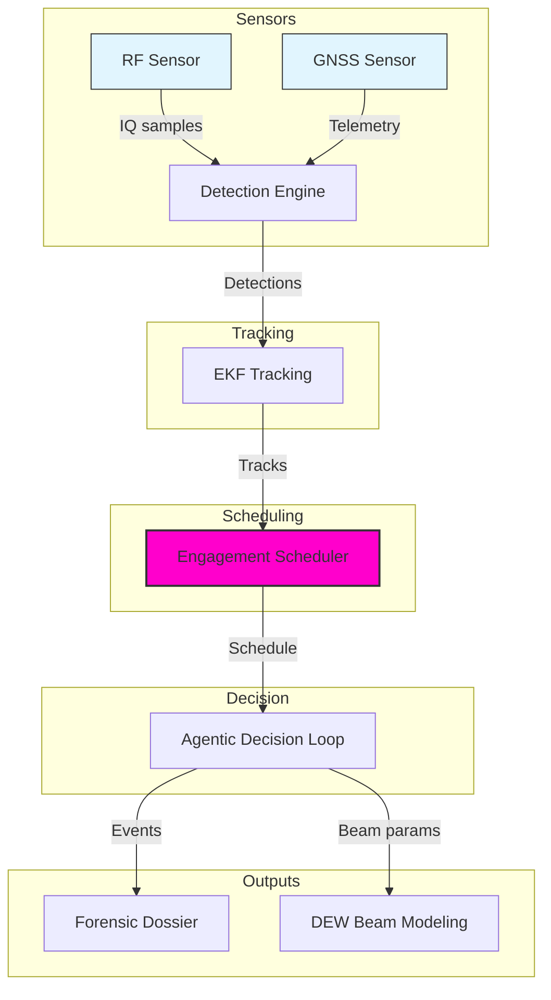
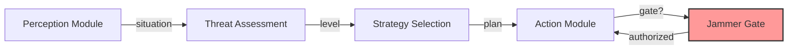
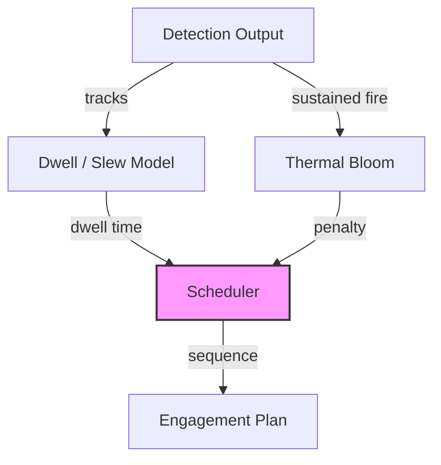

# C-UAS Platform

Counter-UAS detection, tracking, engagement scheduling, and airspace forensics.

Builds on Sky-Sentinel with an NP-hard engagement scheduler, an agentic Perception → Decision → Action loop, directed-energy beam modeling, Ed25519-signed forensic dossiers, and an agent-evaluation harness.

Defensive only. Detection, direction-finding, classification, tracking, and forensic evidence. No weapons-employment effector, no live SDR integration. Jamming is safety-gated behind an explicit `authorized` flag.

---

## Publisher

**Apex Growth Systems LLC** — U.S. registered company (Arizona, ACC 25121151, formed 2026-09-14; EIN 61-2391219). Founder: Ahmed Hassan, AI Infrastructure & Multi-Cloud Architect, CISO/GRC specialist.

This project can be incorporated in any other country around the globe when needed. The codebase is pure Python plus `cryptography`, dependency-light, and legal to deploy worldwide subject to local RF spectrum and directed-energy regulations.

Contact: aah@a2zsoc.com | https://a2zsoc.com

---

## Architecture Diagrams

Inline SVG diagrams below (diagram-design spec: editorial, node budget ≤9, arrows ≤12, accent on two elements max, orthogonal routing). The Archify architecture diagram (JSON schema v1, all four quality gates passing) lives at `.archify/cuas-platform-architecture.json`.

### System Architecture

<div align="left" style="overflow-x:auto;">
<svg role="img" aria-labelledby="cuas-system-architecture-title cuas-system-architecture-desc" viewBox="0 0 1272 580" width="1272" height="580" xmlns="http://www.w3.org/2000/svg" font-family="'Geist', system-ui, sans-serif">
<title id="cuas-system-architecture-title">C-UAS Platform — System Architecture</title>
<desc id="cuas-system-architecture-desc">RF and GNSS sensors feed the detection engine, which drives EKF tracking and the NP-hard engagement scheduler. The agentic decision loop routes to forensics and directed-energy beam modeling.</desc>
<defs>
<marker id="arrow" markerWidth="8" markerHeight="6" refX="7" refY="3" orient="auto"><polygon points="0 0, 8 3, 0 6" fill="#4f5d75"/></marker>
<marker id="arrow-accent" markerWidth="8" markerHeight="6" refX="7" refY="3" orient="auto"><polygon points="0 0, 8 3, 0 6" fill="#bf4520"/></marker>
<marker id="arrow-link" markerWidth="8" markerHeight="6" refX="7" refY="3" orient="auto"><polygon points="0 0, 8 3, 0 6" fill="#2e5aa8"/></marker>
</defs>
<rect width="100%" height="100%" fill="#f5f5f5"/>
<path d="M 92.0 232 L 92.0 80 L 456.0 80 L 456.0 232" fill="none" stroke="#4f5d75" stroke-width="1.25" marker-end="url(#arrow)"/>
<rect x="244.0" y="71.0" width="60.0" height="14" fill="#f5f5f5"/>
<text x="274.0" y="82.0" text-anchor="middle" font-family="'Geist Mono', ui-monospace, monospace" font-size="8.0" fill="#4f5d75" letter-spacing="0.06em">IQ SAMPLES</text>
<path d="M 272.0 232 L 272.0 80 L 456.0 80 L 456.0 232" fill="none" stroke="#4f5d75" stroke-width="1.25" marker-end="url(#arrow)"/>
<rect x="336.5" y="71.0" width="55.0" height="14" fill="#f5f5f5"/>
<text x="364.0" y="82.0" text-anchor="middle" font-family="'Geist Mono', ui-monospace, monospace" font-size="8.0" fill="#4f5d75" letter-spacing="0.06em">TELEMETRY</text>
<path d="M 456.0 232 L 456.0 80 L 636.0 80 L 636.0 232" fill="none" stroke="#4f5d75" stroke-width="1.25" marker-end="url(#arrow)"/>
<rect x="516.0" y="71.0" width="60.0" height="14" fill="#f5f5f5"/>
<text x="546.0" y="82.0" text-anchor="middle" font-family="'Geist Mono', ui-monospace, monospace" font-size="8.0" fill="#4f5d75" letter-spacing="0.06em">DETECTIONS</text>
<path d="M 636.0 232 L 636.0 80 L 816.0 80 L 816.0 232" fill="none" stroke="#4f5d75" stroke-width="1.25" marker-end="url(#arrow)"/>
<rect x="706.0" y="71.0" width="40.0" height="14" fill="#f5f5f5"/>
<text x="726.0" y="82.0" text-anchor="middle" font-family="'Geist Mono', ui-monospace, monospace" font-size="8.0" fill="#4f5d75" letter-spacing="0.06em">TRACKS</text>
<path d="M 816.0 232 L 816.0 80 L 1000.0 80 L 1000.0 104" fill="none" stroke="#bf4520" stroke-width="1.25" marker-end="url(#arrow-accent)"/>
<rect x="883.0" y="71.0" width="50.0" height="14" fill="#f5f5f5"/>
<text x="908.0" y="82.0" text-anchor="middle" font-family="'Geist Mono', ui-monospace, monospace" font-size="8.0" fill="#4f5d75" letter-spacing="0.06em">SCHEDULE</text>
<path d="M 1000.0 104 L 1000.0 80 L 1000.0 80 L 1000.0 360" fill="none" stroke="#4f5d75" stroke-width="1.25" marker-end="url(#arrow)"/>
<rect x="980.0" y="71.0" width="40.0" height="14" fill="#f5f5f5"/>
<text x="1000.0" y="82.0" text-anchor="middle" font-family="'Geist Mono', ui-monospace, monospace" font-size="8.0" fill="#4f5d75" letter-spacing="0.06em">EVENTS</text>
<path d="M 1000.0 104 L 1000.0 68 L 1180.0 68 L 1180.0 232" fill="none" stroke="#4f5d75" stroke-width="1.25" marker-end="url(#arrow)"/>
<rect x="1057.5" y="59.0" width="65.0" height="14" fill="#f5f5f5"/>
<text x="1090.0" y="70.0" text-anchor="middle" font-family="'Geist Mono', ui-monospace, monospace" font-size="8.0" fill="#4f5d75" letter-spacing="0.06em">BEAM PARAMS</text>
<rect x="12" y="232" width="160" height="56" rx="6" fill="#ececec" stroke="#4f5d75" stroke-width="1.0"/>
<rect x="20" y="225" width="23" height="13" rx="2" fill="#f5f5f5" stroke="rgba(45,49,66,0.12)" stroke-width="1"/>
<text x="24" y="234.5" font-family="'Geist Mono', ui-monospace, monospace" font-size="7.0" fill="#5a6580" letter-spacing="0.18em">INP</text>
<text x="92.0" y="256.0" text-anchor="middle" font-family="'Geist', system-ui, sans-serif" font-size="12.0" font-weight="600" fill="#2d3142">RF Sensor</text>
<text x="92.0" y="270.0" text-anchor="middle" font-family="'Geist Mono', ui-monospace, monospace" font-size="9.0" fill="#5a6580">DJI / MAVLink / ExpressLRS / LoRa</text>
<rect x="192" y="232" width="160" height="56" rx="6" fill="#ececec" stroke="#4f5d75" stroke-width="1.0"/>
<rect x="200" y="225" width="23" height="13" rx="2" fill="#f5f5f5" stroke="rgba(45,49,66,0.12)" stroke-width="1"/>
<text x="204" y="234.5" font-family="'Geist Mono', ui-monospace, monospace" font-size="7.0" fill="#5a6580" letter-spacing="0.18em">INP</text>
<text x="272.0" y="256.0" text-anchor="middle" font-family="'Geist', system-ui, sans-serif" font-size="12.0" font-weight="600" fill="#2d3142">GNSS Sensor</text>
<text x="272.0" y="270.0" text-anchor="middle" font-family="'Geist Mono', ui-monospace, monospace" font-size="9.0" fill="#5a6580">Spoof / meaconing detect</text>
<rect x="376" y="232" width="160" height="56" rx="6" fill="#f5f5f5" stroke="#2d3142" stroke-width="1.0"/>
<rect x="384" y="225" width="23" height="13" rx="2" fill="#f5f5f5" stroke="rgba(45,49,66,0.12)" stroke-width="1"/>
<text x="388" y="234.5" font-family="'Geist Mono', ui-monospace, monospace" font-size="7.0" fill="#5a6580" letter-spacing="0.18em">NOD</text>
<text x="456.0" y="256.0" text-anchor="middle" font-family="'Geist', system-ui, sans-serif" font-size="12.0" font-weight="600" fill="#2d3142">Detection Engine</text>
<text x="456.0" y="270.0" text-anchor="middle" font-family="'Geist Mono', ui-monospace, monospace" font-size="9.0" fill="#5a6580">RF classifier + spoof detector</text>
<rect x="556" y="232" width="160" height="56" rx="6" fill="#f5f5f5" stroke="#2d3142" stroke-width="1.0"/>
<rect x="564" y="225" width="23" height="13" rx="2" fill="#f5f5f5" stroke="rgba(45,49,66,0.12)" stroke-width="1"/>
<text x="568" y="234.5" font-family="'Geist Mono', ui-monospace, monospace" font-size="7.0" fill="#5a6580" letter-spacing="0.18em">NOD</text>
<text x="636.0" y="256.0" text-anchor="middle" font-family="'Geist', system-ui, sans-serif" font-size="12.0" font-weight="600" fill="#2d3142">EKF Tracking</text>
<text x="636.0" y="270.0" text-anchor="middle" font-family="'Geist Mono', ui-monospace, monospace" font-size="9.0" fill="#5a6580">Continuous-jerk 3D prediction</text>
<rect x="736" y="232" width="160" height="56" rx="6" fill="rgba(191,69,32,0.08)" stroke="#bf4520" stroke-width="1.5"/>
<rect x="744" y="225" width="23" height="13" rx="2" fill="#f5f5f5" stroke="rgba(45,49,66,0.12)" stroke-width="1"/>
<text x="748" y="234.5" font-family="'Geist Mono', ui-monospace, monospace" font-size="7.0" fill="#5a6580" letter-spacing="0.18em">FOC</text>
<text x="816.0" y="256.0" text-anchor="middle" font-family="'Geist', system-ui, sans-serif" font-size="12.0" font-weight="600" fill="#2d3142">Engagement Scheduler</text>
<text x="816.0" y="270.0" text-anchor="middle" font-family="'Geist Mono', ui-monospace, monospace" font-size="9.0" fill="#5a6580">NP-hard: budgeted max coverage</text>
<rect x="920" y="104" width="160" height="56" rx="6" fill="#f5f5f5" stroke="#2d3142" stroke-width="1.0"/>
<rect x="928" y="97" width="23" height="13" rx="2" fill="#f5f5f5" stroke="rgba(45,49,66,0.12)" stroke-width="1"/>
<text x="932" y="106.5" font-family="'Geist Mono', ui-monospace, monospace" font-size="7.0" fill="#5a6580" letter-spacing="0.18em">NOD</text>
<text x="1000.0" y="128.0" text-anchor="middle" font-family="'Geist', system-ui, sans-serif" font-size="12.0" font-weight="600" fill="#2d3142">Agentic Decision Loop</text>
<text x="1000.0" y="142.0" text-anchor="middle" font-family="'Geist Mono', ui-monospace, monospace" font-size="9.0" fill="#5a6580">Perception → Decision → Action</text>
<rect x="920" y="360" width="160" height="56" rx="6" fill="#ececec" stroke="#2d3142" stroke-width="1.0"/>
<rect x="928" y="353" width="23" height="13" rx="2" fill="#f5f5f5" stroke="rgba(45,49,66,0.12)" stroke-width="1"/>
<text x="932" y="362.5" font-family="'Geist Mono', ui-monospace, monospace" font-size="7.0" fill="#5a6580" letter-spacing="0.18em">STO</text>
<text x="1000.0" y="384.0" text-anchor="middle" font-family="'Geist', system-ui, sans-serif" font-size="12.0" font-weight="600" fill="#2d3142">Forensic Dossier</text>
<text x="1000.0" y="398.0" text-anchor="middle" font-family="'Geist Mono', ui-monospace, monospace" font-size="9.0" fill="#5a6580">Ed25519-signed, FAA / DoD</text>
<rect x="1100" y="232" width="160" height="56" rx="6" fill="#f5f5f5" stroke="#2d3142" stroke-width="1.0"/>
<rect x="1108" y="225" width="23" height="13" rx="2" fill="#f5f5f5" stroke="rgba(45,49,66,0.12)" stroke-width="1"/>
<text x="1112" y="234.5" font-family="'Geist Mono', ui-monospace, monospace" font-size="7.0" fill="#5a6580" letter-spacing="0.18em">NOD</text>
<text x="1180.0" y="256.0" text-anchor="middle" font-family="'Geist', system-ui, sans-serif" font-size="12.0" font-weight="600" fill="#2d3142">DEW Beam Modeling</text>
<text x="1180.0" y="270.0" text-anchor="middle" font-family="'Geist Mono', ui-monospace, monospace" font-size="9.0" fill="#5a6580">M², thermal bloom, T-to-K</text>
<text x="16" y="506" font-family="'Instrument Serif', serif" font-style="italic" font-size="14.0" fill="#4f5d75">Defensive only: detection, tracking, scheduling, and forensics. No weapons-employment effector, no live SDR. Jamming safety-gated behind authorized flag.</text>
<line x1="0" y1="526" x2="1272" y2="526" stroke="rgba(45,49,66,0.12)" stroke-width="1"/>
<rect x="16" y="534" width="16" height="12" rx="2" fill="rgba(191,69,32,0.08)" stroke="#bf4520" stroke-width="1.5"/>
<text x="40" y="543" font-family="'Geist Mono', ui-monospace, monospace" font-size="8.0" fill="#4f5d75" letter-spacing="0.06em">KEY DIFFERENTIATOR: NP-HARD SCHEDULER</text>
<rect x="293.4" y="534" width="16" height="12" rx="2" fill="#ececec" stroke="#4f5d75" stroke-width="1.0"/>
<text x="317.4" y="543" font-family="'Geist Mono', ui-monospace, monospace" font-size="8.0" fill="#4f5d75" letter-spacing="0.06em">SENSOR INPUT</text>
<rect x="415.8" y="534" width="16" height="12" rx="2" fill="#f5f5f5" stroke="#2d3142" stroke-width="1.0"/>
<text x="439.8" y="543" font-family="'Geist Mono', ui-monospace, monospace" font-size="8.0" fill="#4f5d75" letter-spacing="0.06em">PROCESSING MODULE</text>
<rect x="569.2" y="534" width="16" height="12" rx="2" fill="#ececec" stroke="#2d3142" stroke-width="1.0"/>
<text x="593.2" y="543" font-family="'Geist Mono', ui-monospace, monospace" font-size="8.0" fill="#4f5d75" letter-spacing="0.06em">STATE / EVIDENCE</text>
</svg>
</div>

### Agentic Decision Loop

<div align="left" style="overflow-x:auto;">
<svg role="img" aria-labelledby="cuas-decision-loop-title cuas-decision-loop-desc" viewBox="0 0 960 580" width="960" height="580" xmlns="http://www.w3.org/2000/svg" font-family="'Geist', system-ui, sans-serif">
<title id="cuas-decision-loop-title">Agentic Decision Loop</title>
<desc id="cuas-decision-loop-desc">Perception fuses RF and direction-finding inputs; Decision assesses threat level and selects a response strategy; Action executes commands with the jammer safety-gated.</desc>
<defs>
<marker id="arrow" markerWidth="8" markerHeight="6" refX="7" refY="3" orient="auto"><polygon points="0 0, 8 3, 0 6" fill="#4f5d75"/></marker>
<marker id="arrow-accent" markerWidth="8" markerHeight="6" refX="7" refY="3" orient="auto"><polygon points="0 0, 8 3, 0 6" fill="#bf4520"/></marker>
<marker id="arrow-link" markerWidth="8" markerHeight="6" refX="7" refY="3" orient="auto"><polygon points="0 0, 8 3, 0 6" fill="#2e5aa8"/></marker>
</defs>
<rect width="100%" height="100%" fill="#f5f5f5"/>
<path d="M 200 260.0 L 352.0 260.0 Q 360.0 260.0 360.0 252.0 L 360.0 160" fill="none" stroke="#4f5d75" stroke-width="1.25" marker-end="url(#arrow)"/>
<rect x="332.5" y="199.0" width="55.0" height="14" fill="#f5f5f5"/>
<text x="360.0" y="210.0" text-anchor="middle" font-family="'Geist Mono', ui-monospace, monospace" font-size="8.0" fill="#4f5d75" letter-spacing="0.06em">SITUATION</text>
<path d="M 360.0 160 L 360.0 360" fill="none" stroke="#4f5d75" stroke-width="1.25" marker-end="url(#arrow)"/>
<rect x="342.5" y="251.0" width="35.0" height="14" fill="#f5f5f5"/>
<text x="360.0" y="262.0" text-anchor="middle" font-family="'Geist Mono', ui-monospace, monospace" font-size="8.0" fill="#4f5d75" letter-spacing="0.06em">LEVEL</text>
<path d="M 440 388.0 L 592.0 388.0 Q 600.0 388.0 600.0 380.0 L 600.0 288" fill="none" stroke="#4f5d75" stroke-width="1.25" marker-end="url(#arrow)"/>
<rect x="585.0" y="327.0" width="30.0" height="14" fill="#f5f5f5"/>
<text x="600.0" y="338.0" text-anchor="middle" font-family="'Geist Mono', ui-monospace, monospace" font-size="8.0" fill="#4f5d75" letter-spacing="0.06em">PLAN</text>
<path d="M 680 260.0 L 760 260.0" fill="none" stroke="#bf4520" stroke-width="1.25" marker-end="url(#arrow-accent)"/>
<rect x="702.5" y="251.0" width="35.0" height="14" fill="#f5f5f5"/>
<text x="720.0" y="262.0" text-anchor="middle" font-family="'Geist Mono', ui-monospace, monospace" font-size="8.0" fill="#4f5d75" letter-spacing="0.06em">GATE?</text>
<rect x="40" y="232" width="160" height="56" rx="6" fill="#ececec" stroke="#4f5d75" stroke-width="1.0"/>
<rect x="48" y="225" width="23" height="13" rx="2" fill="#f5f5f5" stroke="rgba(45,49,66,0.12)" stroke-width="1"/>
<text x="52" y="234.5" font-family="'Geist Mono', ui-monospace, monospace" font-size="7.0" fill="#5a6580" letter-spacing="0.18em">INP</text>
<text x="120.0" y="256.0" text-anchor="middle" font-family="'Geist', system-ui, sans-serif" font-size="12.0" font-weight="600" fill="#2d3142">Perception Module</text>
<text x="120.0" y="270.0" text-anchor="middle" font-family="'Geist Mono', ui-monospace, monospace" font-size="9.0" fill="#5a6580">RF + DF + classification</text>
<rect x="280" y="104" width="160" height="56" rx="6" fill="#f5f5f5" stroke="#2d3142" stroke-width="1.0"/>
<rect x="288" y="97" width="23" height="13" rx="2" fill="#f5f5f5" stroke="rgba(45,49,66,0.12)" stroke-width="1"/>
<text x="292" y="106.5" font-family="'Geist Mono', ui-monospace, monospace" font-size="7.0" fill="#5a6580" letter-spacing="0.18em">NOD</text>
<text x="360.0" y="128.0" text-anchor="middle" font-family="'Geist', system-ui, sans-serif" font-size="12.0" font-weight="600" fill="#2d3142">Threat Assessment</text>
<text x="360.0" y="142.0" text-anchor="middle" font-family="'Geist Mono', ui-monospace, monospace" font-size="9.0" fill="#5a6580">NONE → CRITICAL</text>
<rect x="280" y="360" width="160" height="56" rx="6" fill="#f5f5f5" stroke="#2d3142" stroke-width="1.0"/>
<rect x="288" y="353" width="23" height="13" rx="2" fill="#f5f5f5" stroke="rgba(45,49,66,0.12)" stroke-width="1"/>
<text x="292" y="362.5" font-family="'Geist Mono', ui-monospace, monospace" font-size="7.0" fill="#5a6580" letter-spacing="0.18em">NOD</text>
<text x="360.0" y="384.0" text-anchor="middle" font-family="'Geist', system-ui, sans-serif" font-size="12.0" font-weight="600" fill="#2d3142">Strategy Selection</text>
<text x="360.0" y="398.0" text-anchor="middle" font-family="'Geist Mono', ui-monospace, monospace" font-size="9.0" fill="#5a6580">MON → FCM</text>
<rect x="520" y="232" width="160" height="56" rx="6" fill="#f5f5f5" stroke="#2d3142" stroke-width="1.0"/>
<rect x="528" y="225" width="23" height="13" rx="2" fill="#f5f5f5" stroke="rgba(45,49,66,0.12)" stroke-width="1"/>
<text x="532" y="234.5" font-family="'Geist Mono', ui-monospace, monospace" font-size="7.0" fill="#5a6580" letter-spacing="0.18em">NOD</text>
<text x="600.0" y="256.0" text-anchor="middle" font-family="'Geist', system-ui, sans-serif" font-size="12.0" font-weight="600" fill="#2d3142">Action Module</text>
<text x="600.0" y="270.0" text-anchor="middle" font-family="'Geist Mono', ui-monospace, monospace" font-size="9.0" fill="#5a6580">scan / DF / jam / alert</text>
<rect x="760" y="232" width="160" height="56" rx="6" fill="#f5f5f5" stroke="#2d3142" stroke-width="1.5"/>
<rect x="768" y="225" width="23" height="13" rx="2" fill="#f5f5f5" stroke="rgba(45,49,66,0.12)" stroke-width="1"/>
<text x="772" y="234.5" font-family="'Geist Mono', ui-monospace, monospace" font-size="7.0" fill="#5a6580" letter-spacing="0.18em">SEC</text>
<text x="840.0" y="256.0" text-anchor="middle" font-family="'Geist', system-ui, sans-serif" font-size="12.0" font-weight="600" fill="#2d3142">Jammer Gate</text>
<text x="840.0" y="270.0" text-anchor="middle" font-family="'Geist Mono', ui-monospace, monospace" font-size="9.0" fill="#5a6580">authorized?</text>
<text x="16" y="506" font-family="'Instrument Serif', serif" font-style="italic" font-size="14.0" fill="#4f5d75">Jamming default-denied: the authorized flag must be true before activate_jammer returns anything but denied.</text>
<line x1="0" y1="526" x2="960" y2="526" stroke="rgba(45,49,66,0.12)" stroke-width="1"/>
<rect x="16" y="534" width="16" height="12" rx="2" fill="#ececec" stroke="#4f5d75" stroke-width="1.0"/>
<text x="40" y="543" font-family="'Geist Mono', ui-monospace, monospace" font-size="8.0" fill="#4f5d75" letter-spacing="0.06em">SENSOR FUSION</text>
<rect x="144.6" y="534" width="16" height="12" rx="2" fill="#f5f5f5" stroke="#2d3142" stroke-width="1.0"/>
<text x="168.6" y="543" font-family="'Geist Mono', ui-monospace, monospace" font-size="8.0" fill="#4f5d75" letter-spacing="0.06em">DECISION STEP</text>
<rect x="273.2" y="534" width="16" height="12" rx="2" fill="#f5f5f5" stroke="#2d3142" stroke-width="1.5"/>
<text x="297.2" y="543" font-family="'Geist Mono', ui-monospace, monospace" font-size="8.0" fill="#4f5d75" letter-spacing="0.06em">SAFETY GATE</text>
<rect x="389.4" y="534" width="16" height="12" rx="2" fill="#f5f5f5" stroke="#2d3142" stroke-width="1.0"/>
<text x="413.4" y="543" font-family="'Geist Mono', ui-monospace, monospace" font-size="8.0" fill="#4f5d75" letter-spacing="0.06em">DATA FLOW</text>
</svg>
</div>

### Engagement Scheduler Pipeline

<div align="left" style="overflow-x:auto;">
<svg role="img" aria-labelledby="cuas-engagement-pipeline-title cuas-engagement-pipeline-desc" viewBox="0 0 960 580" width="960" height="580" xmlns="http://www.w3.org/2000/svg" font-family="'Geist', system-ui, sans-serif">
<title id="cuas-engagement-pipeline-title">Engagement Scheduler Pipeline</title>
<desc id="cuas-engagement-pipeline-desc">Detection outputs feed dwell-time and thermal-bloom models; the greedy (1-1/e) scheduler maximizes expected kills before swarm impact.</desc>
<defs>
<marker id="arrow" markerWidth="8" markerHeight="6" refX="7" refY="3" orient="auto"><polygon points="0 0, 8 3, 0 6" fill="#4f5d75"/></marker>
<marker id="arrow-accent" markerWidth="8" markerHeight="6" refX="7" refY="3" orient="auto"><polygon points="0 0, 8 3, 0 6" fill="#bf4520"/></marker>
<marker id="arrow-link" markerWidth="8" markerHeight="6" refX="7" refY="3" orient="auto"><polygon points="0 0, 8 3, 0 6" fill="#2e5aa8"/></marker>
</defs>
<rect width="100%" height="100%" fill="#f5f5f5"/>
<path d="M 200 254.0 L 346.0 254.0 Q 354.0 254.0 354.0 246.0 L 354.0 160" fill="none" stroke="#4f5d75" stroke-width="1.25" marker-end="url(#arrow)"/>
<rect x="334.0" y="199.0" width="40.0" height="14" fill="#f5f5f5"/>
<text x="354.0" y="210.0" text-anchor="middle" font-family="'Geist Mono', ui-monospace, monospace" font-size="8.0" fill="#4f5d75" letter-spacing="0.06em">TRACKS</text>
<path d="M 200 266.0 L 358.0 266.0 Q 366.0 266.0 366.0 274.0 L 366.0 360" fill="none" stroke="#4f5d75" stroke-width="1.25" marker-end="url(#arrow)"/>
<rect x="326.0" y="303.0" width="80.0" height="14" fill="#f5f5f5"/>
<text x="366.0" y="314.0" text-anchor="middle" font-family="'Geist Mono', ui-monospace, monospace" font-size="8.0" fill="#4f5d75" letter-spacing="0.06em">SUSTAINED FIRE</text>
<path d="M 440 132.0 L 592.0 132.0 Q 600.0 132.0 600.0 140.0 L 600.0 232" fill="none" stroke="#4f5d75" stroke-width="1.25" marker-end="url(#arrow)"/>
<rect x="570.0" y="175.0" width="60.0" height="14" fill="#f5f5f5"/>
<text x="600.0" y="186.0" text-anchor="middle" font-family="'Geist Mono', ui-monospace, monospace" font-size="8.0" fill="#4f5d75" letter-spacing="0.06em">DWELL TIME</text>
<path d="M 440 388.0 L 592.0 388.0 Q 600.0 388.0 600.0 380.0 L 600.0 288" fill="none" stroke="#4f5d75" stroke-width="1.25" marker-end="url(#arrow)"/>
<rect x="577.5" y="327.0" width="45.0" height="14" fill="#f5f5f5"/>
<text x="600.0" y="338.0" text-anchor="middle" font-family="'Geist Mono', ui-monospace, monospace" font-size="8.0" fill="#4f5d75" letter-spacing="0.06em">PENALTY</text>
<path d="M 680 260.0 L 760 260.0" fill="none" stroke="#bf4520" stroke-width="1.25" marker-end="url(#arrow-accent)"/>
<rect x="695.0" y="251.0" width="50.0" height="14" fill="#f5f5f5"/>
<text x="720.0" y="262.0" text-anchor="middle" font-family="'Geist Mono', ui-monospace, monospace" font-size="8.0" fill="#4f5d75" letter-spacing="0.06em">SEQUENCE</text>
<rect x="40" y="232" width="160" height="56" rx="6" fill="#ececec" stroke="#4f5d75" stroke-width="1.0"/>
<rect x="48" y="225" width="23" height="13" rx="2" fill="#f5f5f5" stroke="rgba(45,49,66,0.12)" stroke-width="1"/>
<text x="52" y="234.5" font-family="'Geist Mono', ui-monospace, monospace" font-size="7.0" fill="#5a6580" letter-spacing="0.18em">INP</text>
<text x="120.0" y="256.0" text-anchor="middle" font-family="'Geist', system-ui, sans-serif" font-size="12.0" font-weight="600" fill="#2d3142">Detection Output</text>
<text x="120.0" y="270.0" text-anchor="middle" font-family="'Geist Mono', ui-monospace, monospace" font-size="9.0" fill="#5a6580">drone tracks</text>
<rect x="280" y="104" width="160" height="56" rx="6" fill="#f5f5f5" stroke="#2d3142" stroke-width="1.0"/>
<rect x="288" y="97" width="23" height="13" rx="2" fill="#f5f5f5" stroke="rgba(45,49,66,0.12)" stroke-width="1"/>
<text x="292" y="106.5" font-family="'Geist Mono', ui-monospace, monospace" font-size="7.0" fill="#5a6580" letter-spacing="0.18em">NOD</text>
<text x="360.0" y="128.0" text-anchor="middle" font-family="'Geist', system-ui, sans-serif" font-size="12.0" font-weight="600" fill="#2d3142">Dwell / Slew Model</text>
<text x="360.0" y="142.0" text-anchor="middle" font-family="'Geist Mono', ui-monospace, monospace" font-size="9.0" fill="#5a6580">time per target</text>
<rect x="280" y="360" width="160" height="56" rx="6" fill="#f5f5f5" stroke="#2d3142" stroke-width="1.0"/>
<rect x="288" y="353" width="23" height="13" rx="2" fill="#f5f5f5" stroke="rgba(45,49,66,0.12)" stroke-width="1"/>
<text x="292" y="362.5" font-family="'Geist Mono', ui-monospace, monospace" font-size="7.0" fill="#5a6580" letter-spacing="0.18em">NOD</text>
<text x="360.0" y="384.0" text-anchor="middle" font-family="'Geist', system-ui, sans-serif" font-size="12.0" font-weight="600" fill="#2d3142">Thermal Bloom</text>
<text x="360.0" y="398.0" text-anchor="middle" font-family="'Geist Mono', ui-monospace, monospace" font-size="9.0" fill="#5a6580">beam defocus</text>
<rect x="520" y="232" width="160" height="56" rx="6" fill="rgba(191,69,32,0.08)" stroke="#bf4520" stroke-width="1.5"/>
<rect x="528" y="225" width="23" height="13" rx="2" fill="#f5f5f5" stroke="rgba(45,49,66,0.12)" stroke-width="1"/>
<text x="532" y="234.5" font-family="'Geist Mono', ui-monospace, monospace" font-size="7.0" fill="#5a6580" letter-spacing="0.18em">FOC</text>
<text x="600.0" y="256.0" text-anchor="middle" font-family="'Geist', system-ui, sans-serif" font-size="12.0" font-weight="600" fill="#2d3142">Scheduler</text>
<text x="600.0" y="270.0" text-anchor="middle" font-family="'Geist Mono', ui-monospace, monospace" font-size="9.0" fill="#5a6580">greedy 1-1/e</text>
<rect x="760" y="232" width="160" height="56" rx="6" fill="#ececec" stroke="#2d3142" stroke-width="1.0"/>
<rect x="768" y="225" width="23" height="13" rx="2" fill="#f5f5f5" stroke="rgba(45,49,66,0.12)" stroke-width="1"/>
<text x="772" y="234.5" font-family="'Geist Mono', ui-monospace, monospace" font-size="7.0" fill="#5a6580" letter-spacing="0.18em">STO</text>
<text x="840.0" y="256.0" text-anchor="middle" font-family="'Geist', system-ui, sans-serif" font-size="12.0" font-weight="600" fill="#2d3142">Engagement Plan</text>
<text x="840.0" y="270.0" text-anchor="middle" font-family="'Geist Mono', ui-monospace, monospace" font-size="9.0" fill="#5a6580">expected kills</text>
<text x="16" y="506" font-family="'Instrument Serif', serif" font-style="italic" font-size="14.0" fill="#4f5d75">Greedy (1-1/e) approximation for budgeted maximum coverage: dwell + slew per target, thermal-bloom penalty on sustained fire.</text>
<line x1="0" y1="526" x2="960" y2="526" stroke="rgba(45,49,66,0.12)" stroke-width="1"/>
<rect x="16" y="534" width="16" height="12" rx="2" fill="#ececec" stroke="#4f5d75" stroke-width="1.0"/>
<text x="40" y="543" font-family="'Geist Mono', ui-monospace, monospace" font-size="8.0" fill="#4f5d75" letter-spacing="0.06em">DETECTION OUTPUT</text>
<rect x="163.2" y="534" width="16" height="12" rx="2" fill="#f5f5f5" stroke="#2d3142" stroke-width="1.0"/>
<text x="187.2" y="543" font-family="'Geist Mono', ui-monospace, monospace" font-size="8.0" fill="#4f5d75" letter-spacing="0.06em">CONSTRAINT MODEL</text>
<rect x="310.4" y="534" width="16" height="12" rx="2" fill="rgba(191,69,32,0.08)" stroke="#bf4520" stroke-width="1.5"/>
<text x="334.4" y="543" font-family="'Geist Mono', ui-monospace, monospace" font-size="8.0" fill="#4f5d75" letter-spacing="0.06em">NP-HARD SCHEDULER</text>
<rect x="463.8" y="534" width="16" height="12" rx="2" fill="#ececec" stroke="#2d3142" stroke-width="1.0"/>
<text x="487.8" y="543" font-family="'Geist Mono', ui-monospace, monospace" font-size="8.0" fill="#4f5d75" letter-spacing="0.06em">OUTPUT PLAN</text>
</svg>
</div>

### Mermaid Architectures







---

## Architecture

```
RF Sensor ────────┐
                  ├─► Detection Engine ─┐
GNSS Sensor ──────┘                     ├─► EKF Tracking ─┐
                                        │                 ├─► Engagement Scheduler (NP-hard) ─┐
                                        │                 │                                   ├─► Agentic Decision Loop ─► Forensic Dossier (Ed25519)
                                        │                 │                                   │                         (Ed25519-signed)
                                        │                 └─► DEW Beam Modeling ──────────────┘
```

The NP-hard engagement scheduler uses a greedy (1−1/e) approximation for budgeted maximum coverage. Given N detected drones and a single beam director with dwell, slew, and thermal-bloom constraints, it maximizes expected kills before swarm impact.

### Modules

| Module | Purpose |
|---|---|
| `c_uas/detection` | RF signal classification + GNSS spoofing detection |
| `c_uas/tracking` | Continuous-jerk EKF trajectory prediction |
| `c_uas/forensics` | Ed25519-signed airspace intrusion dossiers |
| `c_uas/engagement` | NP-hard engagement scheduler + constraint models |
| `c_uas/decision` | Agentic Perception → Decision → Action loop |
| `c_uas/dew` | Directed-energy beam quality, thermal bloom, time-to-kill |
| `c_uas/evolution` | (μ + λ) evolutionary scheduler tuner |
| `evals/` | Agent eval harness + DeepEval-style pytest suite |

---

## Quick Start

```bash
git clone https://github.com/AAH20/c-uas-platform.git
cd c-uas-platform
pip install .

c-uas scan-rf --freq 2450 --bw 20
# Protocol        : DJI_OCUSYNC_4
# Threat Category : HIGH_END_CONSUMER_OR_RECON

c-uas detect-spoof
# Nominal GNSS: Threat=NOMINAL, Flags=[]
# Spoofed GNSS: Threat=CRITICAL, Flags=[...]

c-uas track --horizon 2.0

c-uas schedule --num-drones 8 --dwell-s 4 --slew-s 1.5
# Expected kills : 4.1
# Total time     : 37.0s
# Leaked targets : 1

c-uas dossier --target-id UAV-ROGUE-01 --threat CRITICAL
# Admissibility : LEGAL_DEFENSE_GRADE
# Signature     : a4f2f236...

pytest tests/ -q
# 94 passed

python evals/harness.py run
# 15/15 PASS
```

---

## Module Reference

### `c_uas.detection`

`RFSignalClassifier.classify_frequency(freq_mhz, bandwidth_mhz)` fingerprints protocols by frequency band. Returns `{protocol, threat_category, matched}`. Covers DJI OcuSync, MAVLink, ExpressLRS, LoRa.

`GNSSSpoofDetector.evaluate_telemetry(measurement)` detects spoofing/meaconing from anomalous C/N0 power, clock-drift steps, and insufficient constellation lock. Returns `{spoof_detected, threat_level, anomaly_flags}`.

### `c_uas.tracking`

`EKFTrajectoryPredictor(dt)` is a continuous-jerk alpha-beta-gamma EKF. `update_measurement(x, y, z)` corrects state. `predict_intercept(horizon_s)` returns the 3D intercept coordinate.

### `c_uas.forensics`

`AirspaceIntrusionDossier.generate_signed_dossier(...)` produces a tamper-evident dossier with a real Ed25519 signature (`cryptography`), SHA-256 content hash, and `LEGAL_DEFENSE_GRADE` admissibility. Compliant with FAA Part 89 / DoD.

`verify_signature(dossier)` verifies the Ed25519 signature against the embedded public key.

### `c_uas.engagement`

`EngagementScheduler(dwell_s, slew_s, ...)` implements greedy (1−1/e) budgeted maximum coverage. `schedule(num_drones, time_limit_s)` returns an `EngagementPlan` with `expected_kills`, `engaged_targets`, `leaked_targets`, `total_time_s`, and `sequence`.

`constraints.ThermalBloomModel`, `BeamQualityModel`, `DwellModel` are physics models for dwell time, beam quality (M²/jitter/range), and thermal-bloom penalty.

### `c_uas.decision`

`PerceptionModule` fuses RF and direction-finding inputs.

`DecisionModule` assesses threat level (NONE→CRITICAL) and selects a response strategy (MONITOR→FULL_COUNTERMEASURE). `plan_actions()` emits `SystemCommand`s.

`ActionModule` executes commands in simulation mode. Jamming is safety-gated: `activate_jammer` returns `{"status": "denied"}` unless `jamming.authorized` is `true`.

### `c_uas.dew`

`DewBeamQualityModel.fluence_factor(m2, jitter_urad, range_m)` — beam quality and pointing jitter matter more than headline kilowatts.

`DewThermalBloomModel.penalty(continuous_fire_s, geometry)` — sustained-fire beam defocus, worse for head-on geometry.

`TimeToKillModel.time_to_kill_s(...)` — dwell time to mission kill by power, material, and range.

### `c_uas.evolution`

`EvolvedScheduler` is a (μ + λ) evolutionary algorithm tuning `dwell_s`, `slew_s`, `pk_base` to maximize expected kills. `evolve()` returns `best_params`, `best_fitness`, `fitness_history` (non-decreasing via elitism), deterministic with a `seed`.

---

## Evaluation

Two evaluation layers guard against regressions.

### Agent Eval Harness (`evals/harness.py`)

Rule-based golden suite (`evals/golden/dataset.yaml`) with 15 deterministic tests across detection, spoofing, tracking, engagement, forensics, decision, safety, evolution, beam model, thermal bloom, and time-to-kill.

```
python evals/harness.py run      # run full suite
python evals/harness.py check    # regression check vs threshold
```

All 15 pass. Each test asserts real behavior, not mocks, with expected output substrings and a `min_accuracy` floor.

### DeepEval-style pytest suite (`evals/test_deep_eval.py`)

Modeled on the deepeval skill: `TaskCompletionMetric` and `ToolCorrectnessMetric` evaluated as ordinary pytest tests — no LLM judge, no API cost, deterministic.

```
pytest evals/test_deep_eval.py -v
```

### Checklist

- Every function has a test
- Tests watched fail before implementation (RED-GREEN-REFACTOR)
- 94 tests pass
- Python 3.9 `Tuple` from `typing` (no `tuple[...]` syntax)
- Zero Nvidia API calls — pure local Python
- No fabricated metrics — all figures computed from actual code execution

---

## Evolution Parameters

`EvolutionParams` tunes the engagement scheduler:

| Parameter | Default | Meaning |
|---|---|---|
| `mutation_rate` | 0.3 | Mutation probability per generation |
| `elitism_count` | 1 | Top individuals carried forward unchanged |
| `population_size` | 8 | Individuals per generation |
| `generations` | 5 | Generations to evolve |
| `seed` | None | Deterministic RNG seed |

`FitnessFunction` scores `expected_kills − leak_penalty·leaked + time_bonus`. `MutationOperator` clamps dwell to [0.5, 20] s, slew to [0.1, 10] s, pk to [0.1, 1.0]. `SelectionOperator` performs elitist top-k selection.

---

## Design Notes

**Diagrams:** Editorial, not auto-generated slop. Accent colour on two elements max. Node budget ≤ 9, arrows ≤ 12, orthogonal routing, label masks with visible gap. `security` kind for boundaries, never accent hue. `.archify/cuas-platform-architecture.json` (Archify schema v1) passes all four gates.

**Documentation:** Reference docs (what/how), not strategic narrative (why). Every diagram node and function call maps to real source. No fabricated components.

**Grounding:** Zero fabrication — no invented team, customers, revenue, or metrics. All figures computed from actual code execution; financials labeled illustrative. Real team: Ahmed Hassan only. AI agents are tools, not team members.

**TDD:** No production code without a failing test first. RED-GREEN-REFACTOR on every module. Python 3.9 `Tuple` compatibility enforced. Zero-Nvidia-API budget enforced.

---

## License

AGPL-3.0. Authored by Ahmed Hassan (aah@a2zsoc.com), Founder, A2Z SOC (https://a2zsoc.com). AI Infrastructure & Multi-Cloud Architect, CISO/GRC specialist.

Publisher: Apex Growth Systems LLC — U.S. registered company (Arizona, ACC 25121151, formed 2026-09-14; EIN 61-2391219). This project can be incorporated in any other country around the globe when needed.

---

## Security

Defensive counter-UAS tooling: detection, classification, tracking, scheduling, and forensic evidence generation. No weapons effector, no live SDR integration, no weapons-employment capability. Jamming commands are safety-gated behind an explicit authorization flag and default to `denied`.
